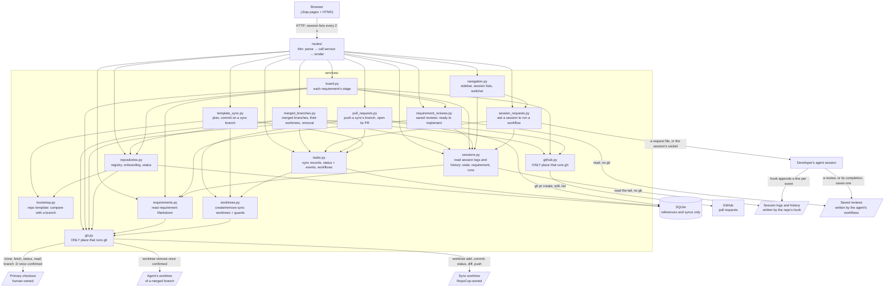
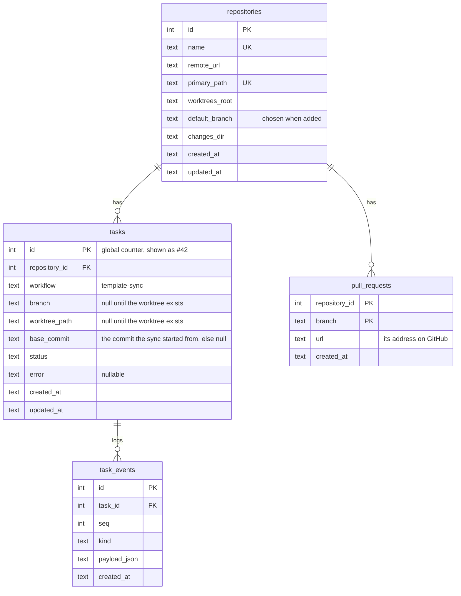

# Architecture — RepoCop

Root design file. It says *how* RepoCop is built: its goals, its main parts and what each may depend on, the contracts between them, its key flows, and where things live. *Why* is in [product.md](product.md), how each area behaves is in its area spec, listed in [index.md](index.md), and why an architecturally significant choice was made is in [decisions/](decisions/). How a module does its work is in its own docs. Diagrams are Mermaid, so they stay text, diffable, and mergeable. Changes in flight: [changes/todo/](changes/todo/)

## Goals

```text
repository owns knowledge         → CLAUDE.md, .claude/, specs/ live in each repo
the developer's agent does work   → in their own agent tool; RepoCop runs no coding agent
sessions report themselves        → each repo's hook logs events in <git common dir>/repocop/sessions/
a requirement's history lasts     → the same hook keeps every workflow run in <git common dir>/repocop/history.jsonl
a review saves its verdict        → a review, or its completion, is saved in <git common dir>/repocop/reviews/
a click asks a session            → a workflow and a requirement, handed over by its own hook or socket
RepoCop shows and syncs           → the board from each repo and GitHub; SQLite: registry, template syncs
worktree owns isolated changes    → 1 template sync ↔ 1 branch ↔ 1 worktree under <worktrees_root>/<repo>/
human keeps final control         → RepoCop writes in a primary checkout only on a click: a fetch, a session request, or a merged branch's removal once confirmed; no auto-push/merge/delete
```

## Components



- **One process.** FastAPI + Uvicorn on `127.0.0.1`. RepoCop runs no coding agent and nothing in the background: each git or `gh` call runs in the request that asks for it, with a timeout, and a template sync is committed within the request that applies it. It learns what agents do from the logs their sessions write ([sessions.md](sessions.md)).
- **No duplicated knowledge.** The DB stores references, metadata and the record of template syncs, never requirement names, text, or repo config: those are read from the repo. Git facts (current branch, status, diff) are queried live.
- **Only RepoCop's own pages change state.** A state-changing request that a browser says a page on another origin sent is refused (`.claude/rules/safety.md` › Network exposure), and a request that carries no word of its origin isn't a browser's, so it is served. The check takes the browser's word for which host it asked, so it doesn't stop DNS rebinding, where another site's name is made to resolve to RepoCop: that takes a list of the host names RepoCop answers to, which it doesn't have.
- **Safety** rules for processes, paths and the primary checkout are in `.claude/rules/safety.md`.

### Areas

Each component serves one of RepoCop's broad areas, and each area's behaviour is stated in its own spec, listed in [index.md](index.md):

| Area | Its components |
|------|----------------|
| [Repositories](repositories.md) | `repositories.py`, `merged_branches.py`, `git.py` |
| [Board](board.md) | `board.py`, `github.py` |
| [Requirements](requirements.md) | `requirements.py`, `backlog.py`, `requirement_reviews.py` |
| [Sessions](sessions.md) | `sessions.py`, `session_requests.py`, and the repo template's session hook |
| [Template sync](template-sync.md) | `template_sync.py`, `bootstrap.py`, `worktrees.py`, `tasks.py`, `pull_requests.py` |
| [Repo template](repo-template.md) | `templates/default-repo/` |
| [UI](ui.md) | `navigation.py`, `routes/`, `templates/`, `static/` |

## Contracts

What one part relies on another for, where the two can change apart: a repository can run an older copy of the template than RepoCop expects, and another agent's hook can write what the template's hook does. Each is stated in full in one place:

| Contract | Between | Stated in full in |
|----------|---------|-------------------|
| The session log, and the history of workflow runs | the template's session hook, or another agent's, and `sessions.py` | [sessions.md › The session log](sessions.md#the-session-log) |
| A request to a session, its delivered record, and the message on a session's socket | `session_requests.py`, the hook's `deliver`, and Claude Code | [sessions.md › Session requests](sessions.md#session-requests) |
| A saved review of a requirement | the template's `save-review.sh` and `requirement_reviews.py` | [requirements.md › A requirement's review](requirements.md#a-requirements-review) |
| A change's name, its archive stamp and what it depends on | the template's skills and `backlog.sh`, and `requirements.py` and `backlog.py` | `.claude/rules/specs.md` › Changes and › Dependencies; `tests/test_backlog.py` holds `backlog.py` and `backlog.sh` to the same order |
| A branch's requirement | whoever names a branch, and `board.py` and `sessions.py` | `.claude/rules/specs.md` › A branch's requirement |
| The template's file kinds, its placeholder and the managed marker | `templates/default-repo/` and `bootstrap.py` | [template-sync.md › File kinds](template-sync.md#file-kinds) |
| A review by Codex | `.reviews/review.sh` and the Codex CLI | [repo-template.md › Branch reviews](repo-template.md#branch-reviews) |
| The database | `db.py` and the services | [Data model](#data-model) |
| Configuration | `config.py` and every other module | [Configuration](#configuration) |
| Which modules run a process, and what they may import | `git.py`, `github.py` and the rest | `.claude/rules/safety.md` › Processes and `.claude/rules/python.md`, held by `tests/test_architecture.py` |

## Data model



- A task records one template sync. Task ids are a global counter, never reused. The database holds nothing of a requirement: its name is its file name, read from the repository with its text.
- `tasks.status` ∈ `queued | running | completed | failed`, moving as [template-sync.md › Status machine](template-sync.md#status-machine) says.
- Stored values never name the product, so a rename leaves stored data alone: a sync that a restart cut off fails as `app_restarted`.
- `task_events` is an append-only log, `kind` ∈ `status_change | error | raw`: the sync's status changes, its error, and what it committed.
- `pull_requests` holds the address of the pull request a sync's branch last had open, one per branch. The pull request itself is on GitHub.

`repocop/db.py` owns the SQLite file and its forward-only migrations, run at startup. A database from a newer RepoCop is refused.

## Coding agents

RepoCop runs none, and isn't tied to one vendor's. What in it is specific to one agent is kept to a few places, which `.claude/rules/agents.md` lists and `tests/test_architecture.py` holds the code to: where a repository's workflows are found, `.claude/skills`, the line that runs one, `/<workflow> <path>`, where the template's hook that records sessions lives, and the message a request is sent to a session's socket as, all Claude Code's. The session log's format is RepoCop's own, so reading it needs no agent's module. The repo template ships `CLAUDE.md` and `.claude/` for Claude Code, and `AGENTS.md` for Codex.

## Configuration

`repocop/config.py` is the only module that reads config files or the environment: every other module takes its settings from it, an immutable pydantic model that its own small loader fills, without `pydantic-settings`. What each key means, and its default, is in `repocop.example.yaml`; where the file is found, how the environment overrides it and what loading refuses, in `config.py`. A configuration that is refused stops RepoCop before it serves anything, saying why. Nothing is read under the product's former name, and nothing is moved for the developer: a config file, data folder or environment variable found only under that name is refused, with how to carry it over. The default host is `127.0.0.1`, and binding anywhere else logs a warning, because v0.1 has no authentication.

## Deployment portability

Nothing may assume WSL: all paths come from config (`repocop.example.yaml`). Moving to an Ubuntu VPS means running the same `make run` behind a reverse proxy with auth added, which is out of scope for v0.1.

RepoCop runs from a source checkout (`uv sync` installs it editable). The UI's own assets live inside the package and are found relative to it. `templates/default-repo/` stays at the repo root, because it is content copied into other repos and replaceable through `template_dir`; only its default path in `config.py` refers to it.
