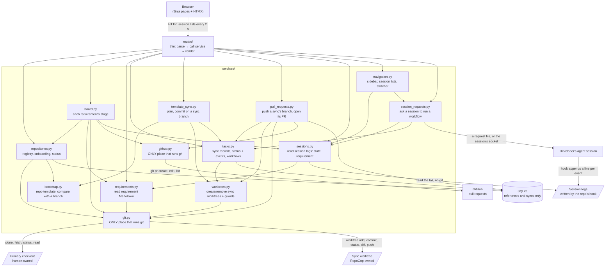
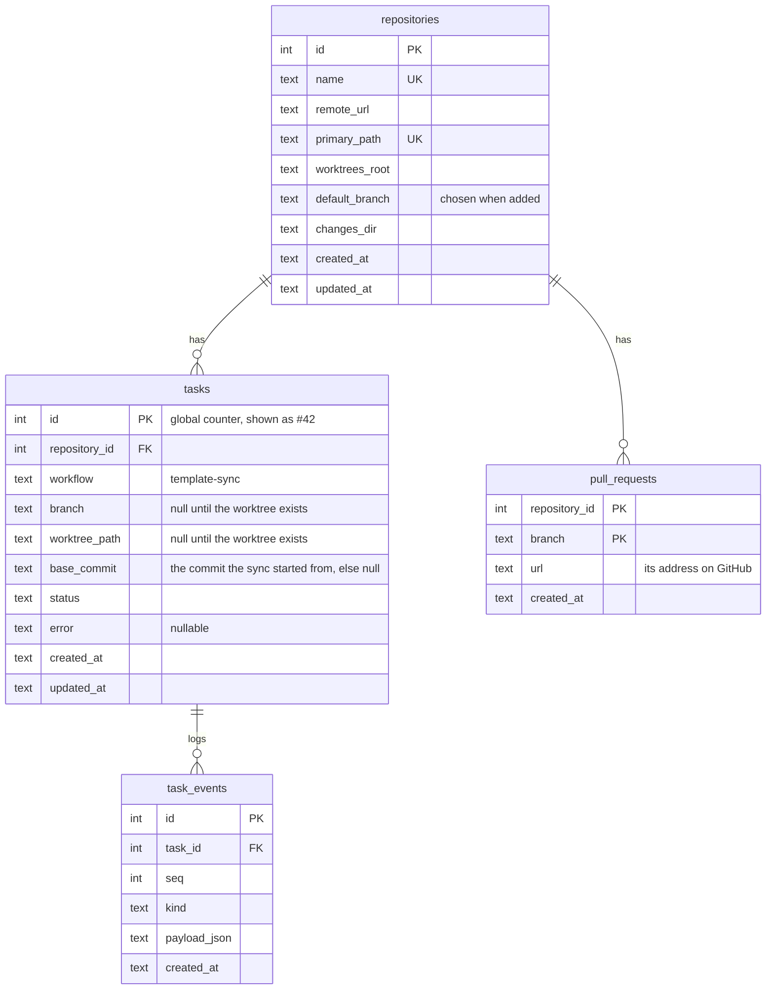
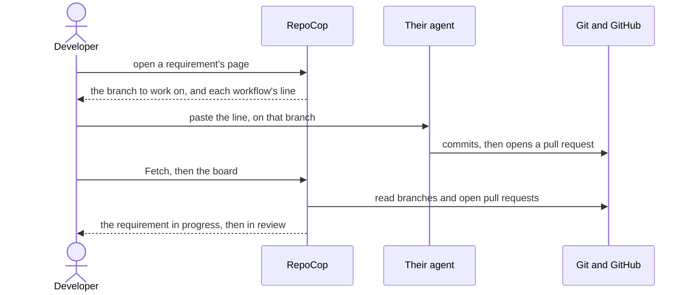
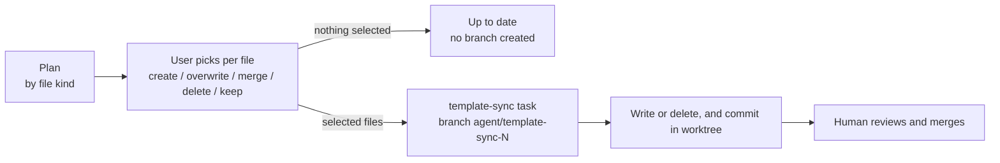
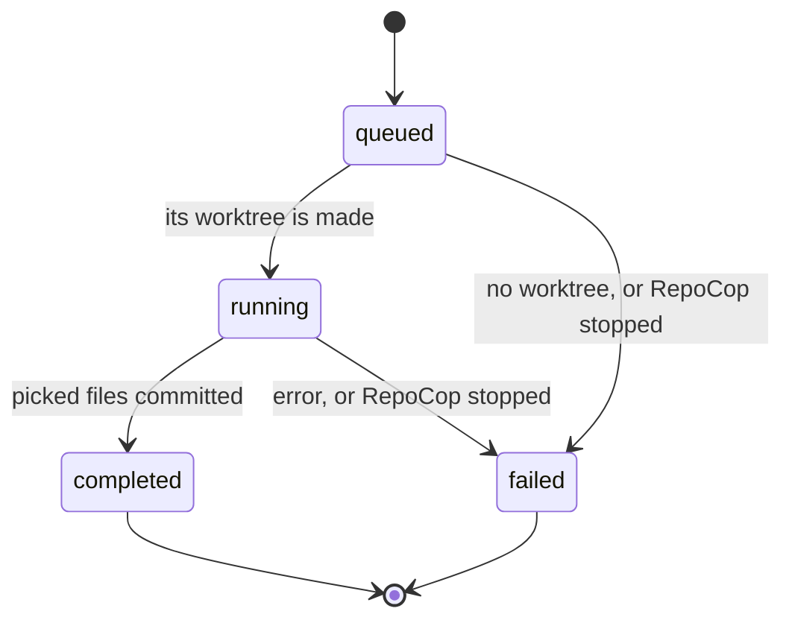

# Architecture — RepoCop

Root design file. It covers *how* the system works; *why* is in [product.md](product.md), and why a significant choice was made is in [decisions/](decisions/). It describes the design, not each module: a module's detailed behaviour is in its docstring. Diagrams are Mermaid, so they stay text, diffable, and mergeable. Changes in flight: [changes/todo/](changes/todo/) · index: [index.md](index.md)

## Principle

```text
repository owns knowledge         → CLAUDE.md, .claude/, specs/ live in each repo
the developer's agent does work   → in their own agent tool; RepoCop runs no coding agent
sessions report themselves        → each repo's hook logs events in <git common dir>/repocop/sessions/
a click asks a session            → a workflow and a requirement, handed over by its own hook or socket
RepoCop shows and syncs           → the board from each repo and GitHub; SQLite: registry, template syncs
worktree owns isolated changes    → 1 template sync ↔ 1 branch ↔ 1 worktree under <worktrees_root>/<repo>/
human keeps final control         → RepoCop's only write in a primary checkout is a fetch; no auto-push/merge/delete
```

## Components



- **One process.** FastAPI + Uvicorn on `127.0.0.1`. RepoCop runs no coding agent and nothing in the background: each git or `gh` call runs in the request that asks for it, with a timeout, and a template sync is committed within the request that applies it. It learns what agents do from the logs their sessions write ([Session events](#session-events)).
- **No duplicated knowledge.** The DB stores references, metadata and the record of template syncs, never requirement names, text, or repo config: those are read from the repo. Git facts (current branch, status, diff) are queried live.
- **Only RepoCop's own pages change state.** Every request but a `GET`, `HEAD` or `OPTIONS` is refused with 403 when the browser says a page on another origin sent it: by `Sec-Fetch-Site`, or else by an `Origin` that isn't the host the request went to. A request with neither header isn't a browser's, and is served. The check takes the browser's word for which host it asked, so it doesn't stop DNS rebinding, where another site's name is made to resolve to RepoCop: that takes a list of the host names RepoCop answers to, which it doesn't have.
- **Safety** rules for processes, paths and the primary checkout are in `.claude/rules/safety.md`.

## Data model



- A task records one template sync. Task ids are a global counter, never reused. The database holds nothing of a requirement: its name is its file name, read from the repository with its text.
- `tasks.status` ∈ `queued | running | completed | failed`
- `task_events` is an append-only log, `kind` ∈ `status_change | error | raw`: the sync's status changes, its error, and what it committed.
- `pull_requests` holds the address of the pull request a sync's branch last had open, one per branch. The pull request itself is on GitHub.

`repocop/db.py` owns the SQLite file: WAL, explicit write transactions, CHECK-constrained enums, and forward-only migrations numbered by `PRAGMA user_version`, run at startup. A database from a newer RepoCop is refused.

## Repository registry and onboarding

- **Adding** takes a remote URL (accepted forms: `.claude/rules/safety.md` › Git remotes), or the name of a checkout already at `<repos_root>/<name>`, whose `origin` is then used. The name sets the paths: the primary checkout at `<repos_root>/<name>`, and the worktrees under `<worktrees_root>/<name>/`.
- **The default branch is chosen, never guessed.** Adding takes two steps. The first shows what adding does, clone or register, and asks which branch is the default, from `origin`'s branches, with the one `origin` names already picked. `origin` is asked directly (`git ls-remote`), which writes nothing, and a checkout whose `origin` can't be reached offers its branches as last fetched. For a remote with no branches yet, the user names the branch its first commit will go on. Nothing is cloned or recorded before the second step. Everything that compares with the default branch on `origin` uses this choice: the template status and sync, the board, and a sync's pull request. The repository's page shows it, and changes it to another of `origin`'s branches as last fetched.
- **No duplicates.** Remotes compare by identity, whatever their spelling.
- **Existing checkouts are registered, never changed**, and only when their `origin` matches. Otherwise RepoCop clones, inside the add request, with a 10-minute timeout.
- **Status** is read on each page load. It's `missing` unless the recorded path is a real folder inside `repos_root` holding a checkout of the registered remote, and git never runs in a path that fails this check. It's `no_commits` before the checkout's first commit, shown as needing one. It's `behind` the template, linking to [Template sync](#template-sync) or, while a finished sync waits to land, to that sync, when the default branch on `origin`, as last fetched, lacks a template file, has one that differs, a merged file that is behind or a marked file the template no longer ships, or can't be compared, and `ready` otherwise. It comes from the same comparison a sync plans with, which reads the branch with two git calls, so neither uncommitted files nor the checkout's own branches hide the need to sync or create one. It reads only what the checkout already has: a partial clone that lacks a file on that branch is never made to download it on a page load, and its Sync page says it couldn't be read.
- **Adding writes nothing into the checkout.** A new repository gets the template's files through a sync, like any other. The template's own rules are in `templates/README.md`.
- **Checkout state** is read from git on each page load, for every checkout that isn't `missing`: the branch or detached commit, an unfinished merge or rebase, the files with uncommitted changes, and the commits ahead of and behind the branch's upstream as last fetched. Nothing is stored, and reading it never rewrites the checkout's index. A git failure is shown for that repository alone.
- **Fetch** happens only on a click. A button on the repository's page fetches `origin` in the primary checkout, which changes its remote-tracking branches and nothing else. It then asks `origin` which branch it names as its default. When that's not the repository's, the page offers to switch, and Fetch all lists it: nothing switches on its own. **Fetch all** on the main page does the same for every repository whose checkout is there, side by side, each with its own timeout, and shows each one's result: one failing doesn't stop the others. No page load fetches, and nothing fetches in the background.
- **Git never prompts**, and every call has a timeout, so a missing credential or unknown host key fails fast instead of hanging.

## Fleet board

The main page answers the product's question across every repository at once: is each one in step with the repo template, and where does its work stand? Its board shows every requirement of every repository whose checkout is there by its stage, read from the repository itself and GitHub, however and by whomever the work was done. The table under it shows each checkout, and how many files a sync would offer a repository behind the template.

A requirement is in the first stage that applies:

| Stage | When |
|-------|------|
| Delivered | archived within the past week by its archive stamp, in the checkout or on the default branch on `origin` as last fetched. One archived earlier, or without a stamp, isn't shown |
| In review | a branch that belongs to it has an open pull request |
| In progress | a branch that belongs to it has commits that default branch lacks, or a session working on it is working, needs input or waits for an instruction |
| To do | anything else in the requirements folder that `origin` hasn't archived, however long ago; its card names what it waits on |

- **Branches.** A branch belongs to a requirement by its name (`.claude/rules/specs.md` › A branch's requirement), whoever made it, local or on `origin` as last fetched. A card names each one, the commits the default branch lacks, and whether `origin` has them all. The local tip counts when there is one. They are read with a fixed number of git calls, whatever their number: one listing of every branch's tip, one walk of the commits the default branch lacks, and one of those `origin` lacks.
- **No default branch from `origin`.** A repository whose checkout lacks it says to fetch first, and its cards show no branch state. A partial clone that lacks the archive on it is never made to download it: the board says it can't be read. An archive name shaped like a stamp that isn't a time counts as unstamped.
- **Pull requests** come from one read-only `gh pr list` per repository, with a 15-second timeout, counting only those whose branch is in the registered repository rather than a fork. They are read side by side, after the page renders: htmx swaps in the board with them, so the page never waits for GitHub. Without JavaScript, a link reloads the page with them read. A repository whose pull requests can't be read says why (no `gh`, logged out, not on github.com, no answer in time), and its cards keep the stage they have without them.
- **Sessions.** A card shows the sessions working on its requirement ([Session events](#session-events)). A repository's sessions that work on no requirement with a card show in its row of the table, as other sessions, so no running work goes unseen. A repository whose default branch on `origin` lacks the hook that records sessions gets a note saying a template sync brings it.
- **Nothing on the board acts.** It only shows: the work is done in the developer's own agent.

## Requirements and the developer's agent

**Identity.** A requirement is a Markdown file in the `todo/` folder of its repository's changes folder, which its developer writes and commits in their own editor, and it has no id. Its file name, without `.md`, is its name on the pages and in commit messages, and its pages are found by its repository and file name: `/repositories/<id>/requirements/<file name>`, the file name percent-encoded, so any name a file can have links to its own page. The file holds its text and no title heading. An older change's heading is part of its text, and an older change's `req-<n>-` prefix is part of its name.

**Read-only.** Nothing in RepoCop creates, edits or commits a requirement file. The repository's page says where to add one, and a requirement's page shows its text as the file holds it, from its folder or the archive, with an "Open in editor" link to that file.

**The developer's agent does the work.** RepoCop runs no coding agent. For an active requirement, its page names the branch to do the work on, the requirement's name (`bulk-user-import`), so the board finds it, and gives the line that runs each of the repository's workflows on it in the developer's own agent: `/implement specs/changes/todo/bulk-user-import.md`. The workflows are the skills committed at HEAD as `.claude/skills/<name>/SKILL.md`. Each line has a Copy button, which the shell's script shows; where the clipboard can't be written, as on a page served neither from the machine itself nor over HTTPS, it selects the line instead, and without the script the line is copied by hand. The agent runs wherever the developer starts it, in the primary checkout or a worktree of their own, such as agent view's, and RepoCop doesn't start, manage or track it.



## Requirement storage

- **One changes folder per repository**, its `changes_dir` (`specs/changes` by default), laid out as the repo template's specs convention says: `todo/` holds the requirements still to deliver, and `/complete-change` archives into `archive/` beside it, under the file's name stamped with the UTC date and time it was archived, so the archive lists changes in the order they finished. An archive made before the stamp keeps its plain name, and RepoCop finds either.
- **Location is read from disk:** `active` at its path, `archived` in the archive folder, `missing` when in neither.
- **Dependencies** come from each change's `depends-on` front matter (`.claude/rules/specs.md`), read from disk on each page load like the rest. The requirements list orders the folder's changes by level: those no undelivered change holds up, then those one undelivered change away, and so on, by their longest chain. Once some change waits on another, each row says what it is blocked by, and a filter shows only the unblocked; until then neither is shown, so a repository that declares no dependencies sees a plain list. Each requirement's page shows what it's blocked by and what it blocks. A problem (a name that matches no change or several, a change that needs itself, a cycle, a list that can't be read) is shown above the list, and the changes it holds up come after the others, marked as unable to be ordered. A name is only compared with the folder's file names, never used to build a path.
- **The template's `specs/changes/backlog.sh` orders the same backlog** outside RepoCop, by the same rules and with the same problems, and draws it as a git-ignored Mermaid graph. RepoCop never runs a repository's scripts, so it applies the rules itself, and `tests/test_backlog.py` holds the two to the same results.

## Session events

RepoCop shows the developer's agent sessions as they work, however and wherever they were started, without launching anything: each session reports itself. The repo template's hook, `.claude/hooks/session-events.sh`, runs in every Claude Code session that runs the repository's project hooks, in the primary checkout or any worktree, from a terminal, VS Code or agent view. It is registered `async` in the template's merged settings, so it never delays or fails a session, and it needs only `sh`, `awk` and `git`. It appends one line per event to `<git common dir>/repocop/sessions/<session id>.jsonl`: a folder every worktree of the repository shares, on the developer's machine, out of every commit. When a session starts, it removes the logs that have gone a week without an event; RepoCop never deletes one.

**The format** is RepoCop's own, so another agent's hook can write it. One JSON object per line:

| Field | Holds |
|-------|-------|
| `v` | the format's version, `1` |
| `at` | when its hook started, in UTC, to the nanosecond where the host's `date` says: `2026-10-29T16:50:01.123456789Z`. Hooks finish in any order, so this, not a line's place in the log, orders events |
| `session` | the session's id, also the log's name |
| `event` | `started`, `moved`, `workflow`, `waiting`, `working`, `turn-finished` or `closed` |
| `cwd`, `branch` | the folder the session is in, and its branch there (`null` off a branch) |
| `pid`, `pid_start` | the agent's process and its start time as `/proc` shows it (`null` where there is none) |
| `socket` | the inbox socket where the agent takes messages, as Claude Code tells its hooks (`null` where it tells none) |
| `workflow`, `argument` | for `workflow`: the skill, and the first line of its argument, at most 200 characters |
| `waiting_for`, `tool` | for `waiting`: `permission` or `answer`, and the tool a permission is for when known |
| `reason` | for `closed`: why, as the agent says (`exit`, `clear`, `logout`, …) |

Nothing else the session said or did is recorded. Claude Code's events map to them as follows:

| Event | From |
|-------|------|
| `started` | `SessionStart`, but for a compaction, which carries on the same session |
| `moved` | `CwdChanged` |
| `workflow` | `UserPromptExpansion` of one of the repository's skills, or `PreToolUse` on `Skill` naming one: typed or chosen by the agent |
| `waiting` | `PermissionRequest`, a `Notification` of a permission prompt or a question, and `PreToolUse` on `AskUserQuestion` |
| `working` | `UserPromptSubmit`, and every `PostToolUse` |
| `turn-finished` | `Stop` |
| `closed` | `SessionEnd` |

These were verified on Claude Code 2.1.312, the oldest version the hook supports. Background sessions run project hooks only in a workspace the developer trusted, which Claude Code looks up by the primary checkout's path.

**What a session shows.** A session shows while it has an event in the past day. Its state comes from its events, and from whether its process still runs:

| State | When |
|-------|------|
| Working | its last event put it to work, and its process runs |
| Needs input | it waits for permission to use a tool, named when known, or for an answer to its question, and its process runs |
| Waiting for instruction | it started, or finished its turn, whether its process still runs or agent view has put it to sleep, which a reply wakes |
| Stopped mid-turn | its process ended while it was working or needed input: it crashed, was killed, or the machine shut down |
| Closed | it ended: it exited, was cleared, or was logged out |

Each shows how long it has been in its state, the workflow it last started, and its branch. Its requirement is the one in the requirements folder, or its archive, whose path in that folder its latest workflow's argument holds, as `/implement specs/changes/todo/bulk-import.md` does, the longest if several and whatever its file is called, or else the one its latest event's branch belongs to (`.claude/rules/specs.md` › A branch's requirement), from the requirements folder or its archive. A requirement's page shows its sessions, a repository's page all of its own, and the sidebar those that need input, in every repository. The process check reads `/proc`, so elsewhere Stopped mid-turn isn't told, and a session shows its last state until a day passes without an event.

**Reading costs little.** Each repository's git common folder is asked of git once, and kept in memory. From then on, a page or a refresh lists the folder and skips logs not written in the past day, however many the rest are, since a session quiet for hours may still be live. It reads each the first time from its end back to its latest workflow, at most 1 MiB, and from then on only what is appended to it, so an unchanged log costs only the look at its size and time the listing took. A log is opened only as a regular file, never through a link and without waiting on a pipe. A log that is another file at its path, told by its first bytes, is read anew. Events are taken in by their time, and one older than the event that last set the state, or the workflow, leaves it as it is. A line that can't be read is skipped. Its process is looked at each time, since it can end without a word. A log is read only as a regular file inside the folder, never through a link. Any local process can write one, so what it says is shown escaped.

**Refreshing.** The shell asks for the session lists every page shows every 2 s, with one request naming each list on the page, and swaps each into place, the sidebar's included: no git call, and no read of GitHub, whose pull requests the board reads once per page load. A card's stage is as of the page load.

## Session requests

From a requirement's page, the developer asks one of its live sessions to run one of the repository's committed workflows on it, which moves the work on without finding the session in a terminal, VS Code or agent view. RepoCop doesn't launch or manage the session: the request reaches it where it runs, and the developer sees it arrive there.

- **Only a click, only a workflow and a requirement.** Each live session of the requirement has its own form, a choice among the skills committed in the repository and a button: no free text. RepoCop refuses a workflow the repository hasn't committed, and a requirement path that would change the request's meaning (a backtick, a backslash, a line break, an absolute path). The session is told: ``The developer asks, from RepoCop: run the `<workflow>` skill with the argument `<path>`.``, a wording verified to make Claude Code call the skill.
- **A session at work gets it when its turn ends.** For a session that is working, or needs input, the request waits as `<git common dir>/repocop/inbox/<session id>.json`: `v`, `id`, `workflow`, `requirement` and `at`. Until then it can be cancelled, and only one waits for a session at a time. When its turn ends, the session's own hook, `session-events.sh deliver`, registered on `Stop` and waited for, takes it by renaming it, so it is delivered once, checks the workflow is a skill committed in the session's checkout and the requirement, its JSON decoded, a file there, and returns Stop's decision to carry on with the wording above as its reason. RepoCop writes the file as UTF-8, escaping only what JSON must. A session's end removes the request still waiting for it.
- **A session waiting for an instruction gets it at once**, through the inbox socket its log names: one line, `{"type":"user","session_id":…,"priority":"later","from":"RepoCop","uuid":…,"message":{"role":"user","content":…}}`, which starts its next turn, or waits for the end of one begun meanwhile. A message whose `session_id` isn't the session's is dropped by Claude Code, so it reaches no other. The socket is used only when it is this user's, a socket, named `<pid>.sock` after the session's recorded process, in a folder no one else can write. A request left just as the session's turn ended, which its hook may have looked for already, is handed over the same way, and one still waiting once the session is idle can be sent from the page. Any local process can write a waiting request, so one RepoCop takes is checked again, against the requirement it was asked for and the committed workflows, and dropped when it fails; one that never reached the session, as when its socket is gone, waits again. A request file is read only as a regular file, never through a link and without waiting on a pipe.
- **Delivered.** Whoever hands a request over records it in `<session id>.delivered.json` beside it, with when. The requirement's page shows a waiting request, then the delivered one, until the session starts its workflow, and says so when that hasn't happened within three minutes.
- **A session that can't be reached says why, and gives the line to run in it instead:** it closed, or stopped mid-turn; it waits for an instruction but its process isn't running, as when agent view has put it to sleep; or its log names no socket, because the hook that recorded it predates requests, so a template sync brings them.

These rest on Claude Code 2.1.312: `Stop`'s `decision: block` carrying the session on at once, and a `later` message on a session's socket starting its next turn, in which it calls the skill named.

## Coding agents

RepoCop runs none, and isn't tied to one vendor's. What in it is specific to one agent is kept to a few places, which `.claude/rules/agents.md` lists and `tests/test_architecture.py` holds the code to: where a repository's workflows are found, `.claude/skills`, the line that runs one, `/<workflow> <path>`, where the template's hook that records sessions lives, and the message a request is sent to a session's socket as, all Claude Code's. The session log's format is RepoCop's own, so reading it needs no agent's module. The repo template ships `CLAUDE.md` and `.claude/` for Claude Code, and `AGENTS.md` for Codex.

## UI approach

Server-rendered Jinja, with HTMX for the quick switcher, the board's pull requests and the session lists, one shared script for the shell, and optional page-specific plain JavaScript or vendored libraries where a page needs more. No SPA framework, npm, bundler, or CDN dependency at runtime. Route handlers stay thin, with logic in `services/`. HTMX is vendored in `repocop/static/vendor/`, and it and the shell's script load on every page.

**The shell.** Every page shares one frame, so an operator sees which session needs them and gets to any repository, requirement or template sync quickly:

- **Sidebar:** the repositories, and the sessions that need input in any of them, each linked to its requirement's page, or else its repository's. In a narrow window it is a native popover behind a Menu button, which needs no script.
- **What the shell shows costs each page little**, whatever the number of repositories and sessions, since it is on every page and refreshes every 2 s: it reads the database and the session logs as files, and once each repository's log folder is known, starts no process. Starting one per repository on each page or refresh is what breaks it.
- **Breadcrumbs** on every page but the repository list, such as Repositories › crm-api › bulk-import, each part a link.
- **Quick switcher:** Ctrl+K (⌘K on macOS), or Jump to…, opens a native `<dialog>` holding a WAI-ARIA combobox. Its options are a server-rendered fragment that HTMX fetches as you type: the repositories and requirements whose name holds what was typed, and the template syncs by number or branch. Requirements are those in each checkout's requirements folder, read as a requirement's page reads them. The script only moves the selection and opens the pick.
- **Shortcuts:** `?` lists them, `g r` goes to the repository list and `g u` one level up, by the breadcrumbs. Single-key shortcuts never fire in a field, and a switch in the list turns them off, remembered in that browser's `localStorage`.
- **Section links** on the repository and template sync pages stay in view and mark the section on screen.
- **Toasts** carry confirmations, such as fetched, removed or copied, in a live region that screen readers announce; errors stay inline. Times read as relative, with the exact time on hover. Help that explains a section folds under **How this works**.

Every page reads and works without JavaScript, but for the switcher, shortcuts and Copy buttons. The stylesheet stays hand-written on the system fonts, built from tokens for colour, space, type, radius and focus, with both colour schemes at WCAG AA contrast and motion following the reduced-motion setting (`.claude/rules/web-ui.md`).

**A template sync's page** shows its status, branch and worktree, what it committed, and its worktree's git status and diff since the base commit, untracked files included. The diff is read-only and capped in size, and the page says when part was left out. A sync is done within the request that applies it, so the page doesn't refresh itself.

**Editor links.** When `editor_url` is configured, a URL template containing `{path}`, each primary checkout, sync worktree and requirement file that is on disk gets an "Open in editor" link built from it. For a file, a slash right after `{path}` is left out, since it would mark a folder. The link is opened by the browser's machine. RepoCop launches nothing, so it also works when the browser isn't on RepoCop's host.

**Remote links.** A repository's remote is shown as its checkout's `origin` has it now, read from git on each page load, so another spelling of the registered remote set since, such as ssh for https, shows as it is. While the checkout is missing, the remote it was registered with is shown. It links to the repository's page on its host, `https://<host>/<path>`, which is where GitHub and hosts laid out like it serve it. A local remote is shown without a link.

## Template sync

Sync is the only way the template reaches a repository, a new one's first files included. Its plan compares each template file (after substitution) against the repo. How a file the repo has is compared depends on its kind, declared in the template's `template.toml`, which is never copied:

| Kind | Missing | Present |
|------|---------|---------|
| managed (default) | create | `identical`, or `differs`: overwrite or keep |
| starter | create | the repository's own: never offered, whatever it holds |
| merged (JSON) | create | `identical` if it has every template entry and value, else `behind the template`: merge, or keep. A file that isn't a JSON object is listed as `can't merge` with the reason |

**Managed files carry a marker** on their first line after any shebang or front matter: `<!-- managed by template -->` in Markdown, `# managed by template` in files whose comments start with `#`. A file on the branch that carries it, but that the template no longer ships, is `removed from the template`: delete, or keep. A file without it is never offered for deletion, whatever its path. The plan finds marked files with one `git grep` of the branch, then reads them and the template's files in one more call.



- **Sync** never writes to the primary checkout. The picked files are committed on a `template-sync` task's own branch, `agent/template-sync-<id>`, in its own worktree, `<worktrees_root>/<repo>/template-sync-<id>`, started from the commit the plan compared with, and the human reviews and merges it through its [pull request](#pull-requests). Nothing picked means no task and no branch. A failure fails the task and keeps the worktree.
- **Its worktree stays in its place.** A worktree is only ever at its path under `<worktrees_root>/<repo>/`. Anything that would put one elsewhere, such as inside a primary checkout, is refused, and a path there counts as the repository's worktree only if its git common directory is the primary checkout's. A folder or branch that is already there is never reused. Every branch RepoCop names starts `agent/`, so a person can tell it from their own.
- **The plan compares with the default branch on `origin`, as last fetched**, not the checkout's own branch or working tree: a merged pull request lands there, and RepoCop never pulls into the checkout. Nothing fetches on its own, so after a sync is merged, Fetch brings the status up to date. Without that branch in the checkout, the plan says to fetch first. Every file the plan offers is picked by default, overwrites and deletions included, since the template is the authority for the files it offers; the user unticks a file to keep the repository's version. Only files the current plan still offers can be applied.
- **A completed sync waits until it lands.** While its worktree is there and its branch has a template file, or a retired file's deletion, that the default branch on `origin` still lacks, the repository's status shows `sync #N not on <default branch>`, linking to the sync's page, where its pull request is pushed and opened. RepoCop learns of a merge only from a fetch, so the repository's page, the sync's page and the Sync page each say what is left, with a Fetch button beside it: open its pull request, or merge the one last known for its branch, then fetch. The Sync page shows this instead of offering picks, and no other sync starts, so the same files are never on two branches. It's judged by the files, so a squash merge counts once it's fetched, and a sync the template has moved past stops waiting.
- **Each completed sync shows where it stands** on the repository's page: `waiting`, `on origin` when every file it changed has the same content on the default branch there, `not on origin` once a newer sync or template change has replaced it, or `removed`. Remove deletes a completed sync's worktree and branch, only on that click and never forced, so it's refused while the worktree has uncommitted changes. A pushed branch and its pull request stay on GitHub, and removing a waiting sync lets Sync offer its files again.
- **The template wins a merge:** keys and array items the repo lacks are added, in template order, and wherever both have a value that isn't an object or array on both sides, or their types differ, the template's replaces the repo's. Keys and array items only the repo has stay. A merge offers again an entry the repo removed or changed on purpose, so a merged template file holds only what every repo must have.
- No template version tracking and no three-way merge. A managed file that differs is kept or overwritten whole.

## Pull requests

A completed template sync's page acts on the pull request of its branch.

| Action | What it does |
|--------|--------------|
| Open PR | Pushes the branch to `origin` with its upstream set, then opens a pull request into the default branch, ready for review, titled "Sync with the repo template" and listing the files it changed, and shows it on GitHub in a new tab |
| Push | Sends the branch's new commits to the pull request |
| Request Copilot review | Asks Copilot to review the pull request, again if it already has |

- **Only on a click.** No sync, status change or page load pushes or writes to GitHub. Until its pull request is opened, a branch is only on RepoCop's host, and its page says so.
- **Refused, with the reason on the page, before anything is pushed:** the cases in `.claude/rules/safety.md` › Pushing, and when `origin` isn't on github.com, when its push URLs (a `pushurl`, or a URL rewrite) send the branch to any repository but the registered remote, where the pull request is opened, or when `gh` is missing or logged out.
- **GitHub is asked at each click.** Every action first asks for the branch's open pull request and remembers it, whoever opened it. A sync's page reads nothing from GitHub when it loads; only the main page's board does, to show stages ([Fleet board](#fleet-board)). With one open, Open PR is refused and the page links to it instead of making a second. With none open, as after a merge, Push and Request Copilot review are refused and Open PR makes a new one. Between clicks the page shows the last one it knew of.
- **GitHub is reached through `gh`**, which is optional: without it only these actions are refused. Merging stays on GitHub, and RepoCop doesn't delete a merged branch or its worktree.

## Branch reviews

A branch is reviewed in the repository, by the developer, with an agent's own built-in review, which its vendor keeps improving. RepoCop runs none. The repo template gives every repository `.reviews/review.sh`, which runs Codex's review of the current branch against the default branch on `origin` as last fetched, read-only, and saves it in `.reviews/`, a folder whose contents git ignores, for `/address-review` to pick up. The script owns its options: the read-only sandbox and the effort, `high` unless `REVIEW_EFFORT` says otherwise, and `tests/test_review_script.py` checks them.

- **Guidance.** A repository says what a review checks and skips in `REVIEW.md`. Codex reads `AGENTS.md`, which points it at the repository's instructions and at `REVIEW.md`. The shared `.claude/rules/reviews.md` says what every review checks: the branch's requirement as context for what the change is for, not as a list of criteria to check, with work beyond it noted rather than reported as a defect; and a bug fix in a tested layer coming with its test, where the shared `.claude/rules/test-policy.md` decides which tests are worth asking for. The repo template ships both as starter files.
- **A review changes nothing.** The script asks for Codex's read-only sandbox by name, as a host's settings can loosen it, refuses a base that isn't there, since Codex would quietly pick another, and refuses uncommitted changes, which Codex would review too.

**Verified against the real CLI** (2026-10-12, Codex CLI 0.162.1; the facts the script and its fake rely on):

1. **Output.** The review alone is on standard output. Progress is on standard error: a header (model, `approval`, `sandbox`), then each command Codex runs, with its output.
2. **Exit codes.** 0 when a review was written. 1 on failure, with an `ERROR:` line on standard error and nothing on standard output.
3. **A missing base isn't a failure.** Given a base that doesn't exist, Codex picks another and reviews against that.
4. **Uncommitted changes are included.** Codex diffs the working tree against the merge base.
5. **Sandbox.** A review runs with `sandbox: read-only` and `approval: never` by default, but a host's `sandbox_mode` setting loosens it. `-c sandbox_mode="read-only"` pins it. The sandbox also stops the reviewer running a repository's checks.
6. **Model.** `-c review_model="<model>"` sets the model the review runs on. The header still names the session's model.
7. **Input.** It doesn't wait on open input. Input is closed anyway.
8. **Guidance.** It reads `AGENTS.md` and follows it to `REVIEW.md`.
9. **Effort.** `-c model_reasoning_effort="<level>"` sets how hard the reviewer thinks. With none set, the header reports `reasoning effort: none`. `high` and `xhigh` are both accepted on the default model.

## Status machine

A template sync's task goes through these within the request that applies it.



- **Restart recovery.** At startup no sync is under way, so a task still `queued` or `running` is one a stopped RepoCop cut off: it becomes `failed`, as `app_restarted`, and its page says RepoCop stopped while it was committing the sync. Its worktree stays as it was. Nothing restarts on its own: a failed sync doesn't wait to land, so the Sync page offers its files again.

## Configuration

`repocop/config.py` is the only module that reads config files or the environment: an immutable pydantic `Settings` model and an explicit loader, whose docstring gives the file search order and the `REPOCOP_<KEY>` overrides. Paths are expanded and resolved, and default state lives under `$XDG_DATA_HOME/repocop`. Loading rejects unknown keys, a retired key with what replaced it (`requirement_path_pattern` and `requirements_dir`, now `changes_dir`), a key only RepoCop's former agent runs used (`claude_bin`, `anthropic_api_key`, `review_model`, `review_effort`), naming it, overlapping `repos_root` and `worktrees_root`, a `changes_dir` outside the repository, and an `editor_url` without exactly one `{path}`, and `make run` then exits with code 2. It also refuses what still goes by the product's former name and would otherwise be ignored: an environment variable named with it, a config file found only at a former location, and a default data folder found only under it while `database_path` and `logs_dir` aren't set. Each refusal gives the command or new name that carries it over, and nothing is moved for the developer. The default host is `127.0.0.1`, and binding anywhere else logs a warning, because v0.1 has no authentication.

## Deployment portability

Nothing may assume WSL: all paths come from config (`repocop.example.yaml`). Moving to an Ubuntu VPS means running the same `make run` behind a reverse proxy with auth added, which is out of scope for v0.1.

RepoCop runs from a source checkout (`uv sync` installs it editable). The UI's own assets live inside the package and are found relative to it. `templates/default-repo/` stays at the repo root, because it is content copied into other repos and replaceable through `template_dir`; only its default path in `config.py` refers to it.
