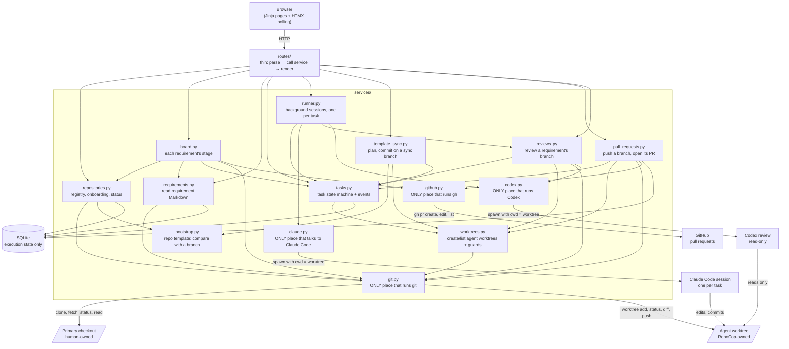
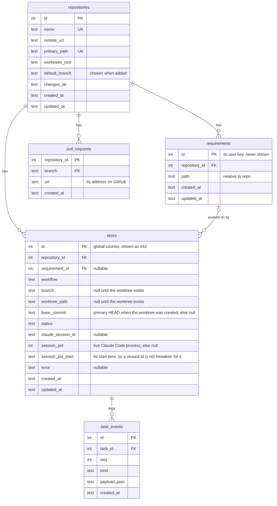
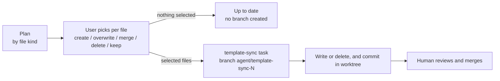
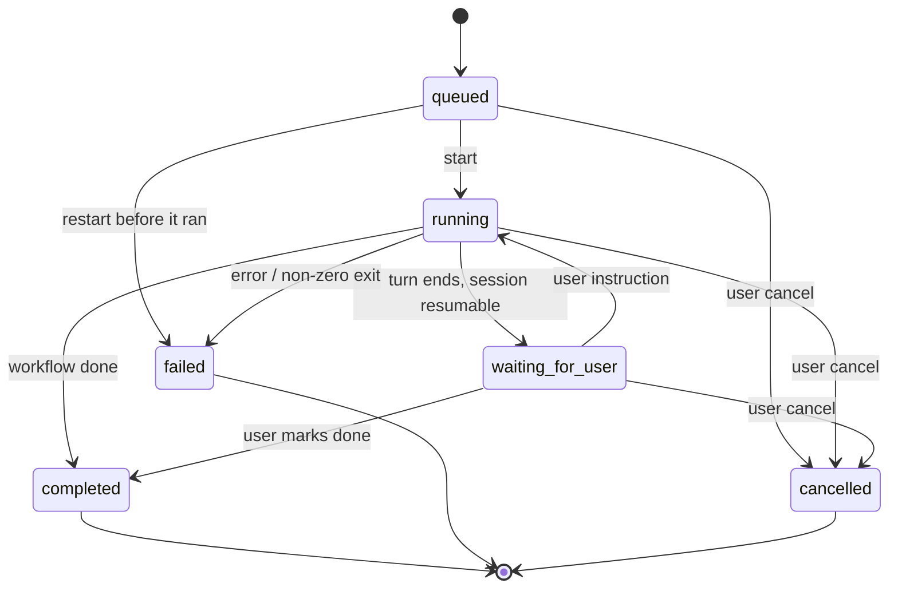
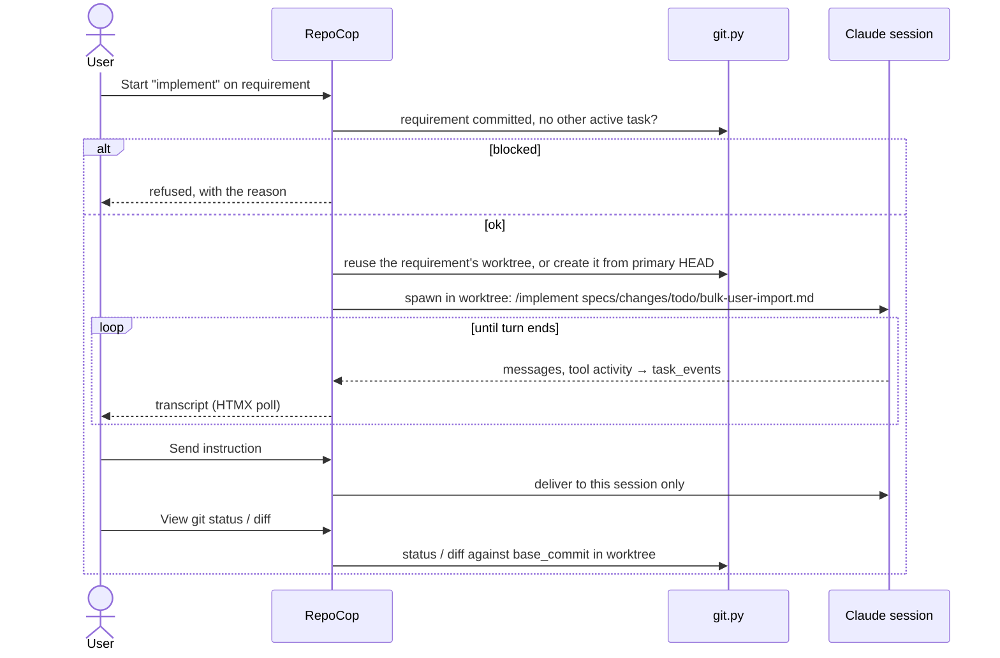

# Architecture — RepoCop

Root design file. It covers *how* the system works; *why* is in [product.md](product.md), and why a significant choice was made is in [decisions/](decisions/). It describes the design, not each module: a module's detailed behaviour is in its docstring. Diagrams are Mermaid, so they stay text, diffable, and mergeable. Changes in flight: [changes/todo/](changes/todo/) · index: [index.md](index.md)

## Principle

```text
RepoCop owns execution            → SQLite: registry, tasks, events, session ids
repository owns knowledge         → CLAUDE.md, .claude/, specs/ live in each repo
worktree owns isolated changes    → 1 requirement ↔ 1 branch ↔ 1 worktree under <worktrees_root>/<repo>/
Claude session owns one task      → 1 task ↔ 1 session; at most one active task per worktree
human keeps final control         → agents never touch the primary checkout; no auto-push/merge/delete
```

## Components



- **One process.** FastAPI + Uvicorn on `127.0.0.1`. Claude sessions and reviews belong to an in-process `TaskRunner` (`services/runner.py`): one asyncio job per task id, on the app's event loop. HTTP handlers only start, send or cancel, and never await a session or a review. Git and file work in those handlers runs in the threadpool.
- **No duplicated knowledge.** The DB stores references, metadata and execution events, never requirement names, text, or repo config: those are read from the repo. Git facts (current branch, status, diff) are queried live.
- **Only RepoCop's own pages change state.** Every request but a `GET`, `HEAD` or `OPTIONS` is refused with 403 when the browser says a page on another origin sent it: by `Sec-Fetch-Site`, or else by an `Origin` that isn't the host the request went to. A request with neither header isn't a browser's, and is served. The check takes the browser's word for which host it asked, so it doesn't stop DNS rebinding, where another site's name is made to resolve to RepoCop: that takes a list of the host names RepoCop answers to, which it doesn't have.
- **Safety** rules for processes, paths and the primary checkout are in `.claude/rules/safety.md`.

## Data model



- Task ids are a global counter. A requirement has no id: its name is its file name, kept only as part of its path, and its row's key is the database's own, never shown. A requirement is recorded only when its first task needs a row for it.
- `tasks.workflow` is a repo skill name (`review-requirement`, `implement`, …) or one of RepoCop's own, `template-sync` and `Codex review`, which have no Claude session.
- All tasks of one requirement share its branch, worktree and base commit, which each records. `git diff <base_commit>` in the worktree shows everything they changed.
- `tasks.status` ∈ `queued | running | waiting_for_user | completed | failed | cancelled`
- `task_events` is an append-only log, `kind` ∈ `user_instruction | assistant_text | tool_use | tool_result | command_output | status_change | error | raw`. The task page polls it for `seq > last_seen`.
- A review's progress is `command_output`, and the review itself an `assistant_text` whose `who` names the reviewer; an event without `who` is Claude's. The `status_change` that completes a review records the commit it covered. Pages read the last finished review from these events, and a task that addresses it is given that text and commit.
- `pull_requests` holds the address of the pull request a RepoCop branch last had open, one per branch. The pull request itself is on GitHub.

`repocop/db.py` owns the SQLite file: WAL, explicit write transactions, CHECK-constrained enums, and forward-only migrations numbered by `PRAGMA user_version`, run at startup. A database from a newer RepoCop is refused.

## Repository registry and onboarding

- **Adding** takes a remote URL (accepted forms: `.claude/rules/safety.md` › Git remotes), or the name of a checkout already at `<repos_root>/<name>`, whose `origin` is then used. The name sets the paths: the primary checkout at `<repos_root>/<name>`, and the worktrees under `<worktrees_root>/<name>/`.
- **The default branch is chosen, never guessed.** Adding takes two steps. The first shows what adding does, clone or register, and asks which branch is the default, from `origin`'s branches, with the one `origin` names already picked. `origin` is asked directly (`git ls-remote`), which writes nothing, and a checkout whose `origin` can't be reached offers its branches as last fetched. For a remote with no branches yet, the user names the branch its first commit will go on. Nothing is cloned or recorded before the second step. Everything that compares with the default branch on `origin` uses this choice: the template status and sync, the board, reviews and pull requests. The repository's page shows it, and changes it to another of `origin`'s branches as last fetched.
- **No duplicates.** Remotes compare by identity, whatever their spelling.
- **Existing checkouts are registered, never changed**, and only when their `origin` matches. Otherwise RepoCop clones, inside the add request, with a 10-minute timeout.
- **Status** is read on each page load. It's `missing` unless the recorded path is a real folder inside `repos_root` holding a checkout of the registered remote, and git never runs in a path that fails this check. It's `no_commits` before the checkout's first commit, shown as needing one. It's `behind` the template, linking to [Template sync](#template-sync) or, while a finished sync waits to land, to that sync, when the default branch on `origin`, as last fetched, lacks a template file, has one that differs, a merged file that is behind or a marked file the template no longer ships, or can't be compared, and `ready` otherwise. It comes from the same comparison a sync plans with, which reads the branch with two git calls, so neither uncommitted files nor the checkout's own branches hide the need to sync or create one. It reads only what the checkout already has: a partial clone that lacks a file on that branch is never made to download it on a page load, and its Sync page says it couldn't be read.
- **Adding writes nothing into the checkout.** A new repository gets the template's files through a sync, like any other. The template's own rules are in `templates/README.md`.
- **Checkout state** is read from git on each page load, for every checkout that isn't `missing`: the branch or detached commit, an unfinished merge or rebase, the files with uncommitted changes, and the commits ahead of and behind the branch's upstream as last fetched. Nothing is stored, and reading it never rewrites the checkout's index. A git failure is shown for that repository alone.
- **Fetch** happens only on a click. A button on the repository's page fetches `origin` in the primary checkout, which changes its remote-tracking branches and nothing else. It then asks `origin` which branch it names as its default. When that's not the repository's, the page offers to switch, and Fetch all lists it: nothing switches on its own. **Fetch all** on the main page does the same for every repository whose checkout is there, side by side, each with its own timeout, and shows each one's result: one failing doesn't stop the others. No page load fetches, and nothing fetches in the background.
- **Git never prompts**, and every call has a timeout, so a missing credential or unknown host key fails fast instead of hanging.

## Fleet board

The main page answers the product's question across every repository at once: is each one in step with the repo template, and where does its work stand? Its board shows every requirement of every repository whose checkout is there by its stage, read from the repository itself and GitHub, however and by whomever the work was done. The table under it shows each checkout, and how many files a sync would offer a repository behind the template.

A requirement is in the first stage that applies:

| Stage | When |
|-------|------|
| Delivered | archived within the past week by its archive stamp, in the checkout or on the default branch on `origin` as last fetched. One archived earlier, or without a stamp, isn't shown |
| In review | a branch that belongs to it has an open pull request |
| In progress | a branch that belongs to it has commits that default branch lacks, or a RepoCop task is active on it |
| To do | anything else in the requirements folder; its card names what it waits on |

- **Branches.** A branch belongs to a requirement by its name (`.claude/rules/specs.md` › A branch's requirement), whoever made it, local or on `origin` as last fetched. A card names each one, the commits the default branch lacks, and whether `origin` has them all. The local tip counts when there is one. They are read with a fixed number of git calls, whatever their number: one listing of every branch's tip, one walk of the commits the default branch lacks, and one of those `origin` lacks.
- **No default branch from `origin`.** A repository whose checkout lacks it says to fetch first, and its cards show no branch state.
- **Pull requests** come from one read-only `gh pr list` per repository, with a 15-second timeout, counting only those whose branch is in the registered repository rather than a fork. They are read side by side, after the page renders: htmx swaps in the board with them, so the page never waits for GitHub. Without JavaScript, a link reloads the page with them read. A repository whose pull requests can't be read says why (no `gh`, logged out, not on github.com, no answer in time), and its cards keep the stage they have without them.
- **Nothing on the board acts.** Reviews and pull request actions stay on a requirement's page, for RepoCop's own branches.

## Requirements, branches and worktrees

**Identity.** A requirement is a Markdown file in the `todo/` folder of its repository's changes folder, which its developer writes and commits in their own editor, and it has no id. Its file name, without `.md`, is its name on the pages, in commit messages and in its pull request's title, and its pages are found by its repository and file name: `/repositories/<id>/requirements/<file name>`, the file name percent-encoded, so any name a file can have links to its own page. The file holds its text and no title heading. An older change's heading is part of its text, and an older change's `req-<n>-` prefix is part of its name.

**Read-only.** Nothing in RepoCop creates, edits or commits a requirement file. The repository's page says where to add one, and a requirement's page shows its text as the file holds it, from its folder or the archive, with an "Open in editor" link to that file. For an active requirement, the page gives the line that runs each of the repository's workflows on it in the developer's own agent session, `/implement specs/changes/todo/bulk-user-import.md`, built by the code that builds a RepoCop task's first prompt, and names the branch to do the work on: the requirement's name, `bulk-user-import`.

**One branch and worktree per requirement.**

| Requirement | Branch | Worktree |
|-------------|--------|----------|
| `bulk-user-import.md` | `agent/bulk-user-import` | `<worktrees_root>/crm-api/bulk-user-import` |
| `login-crash.md` | `agent/login-crash` | `<worktrees_root>/crm-api/login-crash` |
| an older change, `req-7-search.md` | `agent/req-7-search` | `<worktrees_root>/crm-api/req-7-search` |
| no requirement: template sync, task #43 | `agent/template-sync-43` | `<worktrees_root>/crm-api/template-sync-43` |

- The first task on a requirement records it if it isn't yet, and creates its branch and worktree from the primary checkout's HEAD, recorded as the base commit. A file name git won't take as a branch name is refused there, with git's reason. Later tasks (review → implement → address-pr-comments) reuse them, so the PR's branch is the requirement's branch. A worktree that has disappeared isn't recreated, and a branch RepoCop didn't create isn't reused.
- A task's workflow is a skill committed at HEAD as `.claude/skills/<name>/SKILL.md`, since that's what its worktree will contain.
- A worktree is only ever at its path under `<worktrees_root>/<repo>/`. Anything that would put one elsewhere, such as inside a primary checkout, is refused, and a path there counts as the repository's worktree only if its git common directory is the primary checkout's.
- **Every branch RepoCop names starts `agent/`**, so a person can tell its work from their own. A branch named before that keeps its name, and its tasks, reviews and pull request use it as before.
- **Every RepoCop-launched session runs in a worktree**, including `review-requirement`.
- **Several requirements can be in flight in one repository at once**, each in its own worktree. The only limit is one active task per worktree.
- **The primary checkout stays free for the developer's own agent sessions**, where they work on a branch named for the requirement, apart from RepoCop's `agent/` one. RepoCop doesn't detect, manage or track those sessions.

**Commits and freshness.**

- **RepoCop makes no commit in a primary checkout.** Its only write there is a fetch, and a requirement reaches a worktree only once its developer has committed it.
- **An uncommitted requirement blocks task start**, and the reason names the file to commit first. Nothing is copied into a worktree behind the human's back.
- **Edits after a task starts don't reach it.** The human tells the session about them through the instruction box.

## Requirement storage

- **One changes folder per repository**, its `changes_dir` (`specs/changes` by default), laid out as the repo template's specs convention says: `todo/` holds the requirements still to deliver, and `/complete-change` archives into `archive/` beside it, under the file's name stamped with the UTC date and time it was archived, so the archive lists changes in the order they finished. An archive made before the stamp keeps its plain name, and RepoCop finds either.
- **Location is read from disk:** `active` at its path, `archived` in the archive folder, `missing` when in neither.
- **Dependencies** come from each change's `depends-on` front matter (`.claude/rules/specs.md`), read from disk on each page load like the rest. The requirements list orders the folder's changes by level: those no undelivered change holds up, then those one undelivered change away, and so on, by their longest chain, then the delivered and missing requirements. Once some change waits on another, each row says what it is blocked by, and a filter shows only the unblocked; until then neither is shown, so a repository that declares no dependencies sees a plain list. Each requirement's page shows what it's blocked by and what it blocks. A problem (a name that matches no change or several, a change that needs itself, a cycle, a list that can't be read) is shown above the list, and the changes it holds up come after the others, marked as unable to be ordered. A name is only compared with the folder's file names, never used to build a path.
- **The template's `specs/changes/backlog.sh` orders the same backlog** outside RepoCop, by the same rules and with the same problems, and draws it as a git-ignored Mermaid graph. RepoCop never runs a repository's scripts, so it applies the rules itself, and `tests/test_backlog.py` holds the two to the same results.

## Claude Code integration

Claude Code runs the tasks' sessions, and is the only agent that does. What is specific to it stays in `services/claude.py`, and `.claude/rules/agents.md` lists what is still outside that module. Codex only reviews branches: [Branch review](#branch-review).

Sessions run through the Python Claude Agent SDK (`claude-agent-sdk`, `ClaudeSDKClient`), behind `services/claude.py`. It gives a bidirectional session, `interrupt()`, `resume`, `cwd`, a permission mode, and the worktree's project settings: CLAUDE.md, `.claude/rules`, `.claude/skills`, and `settings.json`.

- **Skills** are invoked by name in the prompt: `/review-requirement specs/changes/todo/bulk-user-import.md`. They resolve from the worktree's `.claude/skills/`, so RepoCop hard-codes nothing about what a skill does.
- **Project settings are always loaded.** No "bare" or isolation mode skips repo config.
- **Permissions:** `acceptEdits` plus the repo's own `.claude/settings.json` allowlist, never bypassed. A denied action shows up in the transcript, and the human answers through the instruction box.
- **Authentication:** the host's Claude Code subscription login by default. `ANTHROPIC_API_KEY` and `ANTHROPIC_AUTH_TOKEN` are blanked for every session, then a configured key is set. A session whose `init` reports another credential is stopped with the reason. The main page shows the credential and its state from `claude auth status --json`.
- **Updates.** The session id is stored as soon as `init` arrives; it's the key for resuming and for restart recovery. Messages become visible events (text, tool use, tool results, raw; never thinking; long text clipped), which `services/runner.py` records while it drives the status machine. An instruction goes to the task's live session and is answered as its next turn; for a waiting task, it resumes the session.
- **Continuing in a terminal.** Once no task is active in its worktree, a task's page shows `cd <worktree> && claude --resume <session id>`. It's hidden while any task there is active, because two writers in one session interleave. RepoCop doesn't track what happens in that terminal.
- **Testing.** The default suite fakes the SDK client at `services/claude.py`'s boundary (`tests/fakes/fake_claude.py`), producing the SDK's public message types in the order below, and a guard makes the real client fail.

**Verified against the real CLI** (2026-09-25, Claude Code 2.1.282 and SDK 0.2.159; the facts the code and the fake rely on):

1. **Auth.** With `cli_path` set to the installed CLI (`claude_bin`), the SDK reuses its login. The SDK's bundled CLI is used only when `claude_bin` isn't found.
2. **Messages.** Every turn starts with a `SystemMessage` of subtype `init` carrying `session_id`. Then come `AssistantMessage` blocks (text, tool use, thinking), `UserMessage` blocks (tool results, and "[Request interrupted by user]"), and a `ResultMessage` ending the turn (`subtype`, `is_error`, `result`, `session_id`, `total_cost_usd`). `thinking_tokens` and `status` system messages and rate-limit events also arrive and are ignored.
3. **Mid-turn messages queue.** A `query()` sent while a turn runs is answered as the next turn, after the current one ends. It isn't interleaved.
4. **Skills.** `/skill-name args` expands from the worktree's `.claude/skills` with `setting_sources=["project"]`. A skill is given its arguments in full, line breaks included (checked on 2.1.285).
5. **Interrupt.** `interrupt()` ends the turn with the interrupted user message and a `ResultMessage` of subtype `error_during_execution`.
6. **Credentials.** A token wins even over a key (`authMethod: oauth_token`), which is why both are blanked. `init` reports the credential in use as `apiKeySource`.
7. **Minimum Claude Code version:** 2.1.282, checked by `make doctor`.
8. **Trust** (2026-09-30). Claude Code applies a repository's `permissions.allow` rules only once someone has accepted its trust prompt, and it looks trust up by the primary checkout's path, even from a worktree. Otherwise it ignores them, warning only on stderr, so every allowlisted command is refused. Deny rules still apply.

## UI approach

Server-rendered Jinja, with HTMX for live panels and the quick switcher, one shared script for the shell, and optional page-specific plain JavaScript or vendored libraries where a page needs more. No SPA framework, npm, bundler, or CDN dependency at runtime. Route handlers stay thin, with logic in `services/`. HTMX is vendored in `repocop/static/vendor/`, and it and the shell's script load on every page.

**The shell.** Every page shares one frame, so an operator sees what is running anywhere and gets to any repository, requirement or task quickly:

- **Sidebar:** the repositories, and the active tasks across all of them, each with its status and repository. It reads only the database, so it adds no git call to a page, and while any task is active its task list refreshes from a fragment every 2 s. In a narrow window it is a native popover behind a Menu button, which needs no script.
- **Breadcrumbs** on every page but the repository list, such as Repositories › crm-api › bulk-import › Task #12, each part a link.
- **Quick switcher:** Ctrl+K (⌘K on macOS), or Jump to…, opens a native `<dialog>` holding a WAI-ARIA combobox. Its options are a server-rendered fragment that HTMX fetches as you type: the active tasks before anything is typed, else the repositories, requirements and tasks matching by name, id or branch. Requirements are those in each checkout's requirements folder, read as a requirement's page reads them, and those recorded. The script only moves the selection and opens the pick.
- **Shortcuts:** `?` lists them, `g r` goes to the repository list and `g u` one level up, by the breadcrumbs. Single-key shortcuts never fire in a field, and a switch in the list turns them off, remembered in that browser's `localStorage`.
- **Section links** on the repository and task pages stay in view and mark the section on screen.
- **Toasts** carry confirmations, such as saved, fetched or removed, in a live region that screen readers announce; errors stay inline. Times read as relative, with the exact time on hover. Help that explains a section folds under **How this works**.

Every page reads and works without JavaScript, but for the switcher and shortcuts. The stylesheet stays hand-written on the system fonts, built from tokens for colour, space, type, radius and focus, with both colour schemes at WCAG AA contrast and motion following the reduced-motion setting (`.claude/rules/web-ui.md`).

**Live task page.** While a task is active, its header, transcript (only events after the last `seq` shown) and worktree panel (git status and diff) refresh every 2 s. An inactive task's fragments carry no trigger, so polling stops. The instruction box sits outside them, so typed text is never replaced, and without JavaScript the page still works with a manual refresh. The diff is read-only and covers everything since the base commit, including untracked files. It's capped in size, and the page says when part was left out.

**Editor links.** When `editor_url` is configured, a URL template containing `{path}`, each primary checkout, worktree and requirement file that is on disk gets an "Open in editor" link built from it. For a file, a slash right after `{path}` is left out, since it would mark a folder. The link is opened by the browser's machine. RepoCop launches nothing, so it also works when the browser isn't on RepoCop's host.

**Remote links.** A repository's remote is shown as its checkout's `origin` has it now, read from git on each page load, so another spelling of the registered remote set since, such as ssh for https, shows as it is. While the checkout is missing, the remote it was registered with is shown. It links to the repository's page on its host, `https://<host>/<path>`, which is where GitHub and hosts laid out like it serve it. A local remote is shown without a link.

## Template sync

Sync is the only way the template reaches a repository, a new one's first files included. Its plan compares each template file (after substitution) against the repo. How a file the repo has is compared depends on its kind, declared in the template's `template.toml`, which is never copied:

| Kind | Missing | Present |
|------|---------|---------|
| managed (default) | create | `identical`, or `differs`: overwrite or keep |
| starter | create | the repository's own: never offered, whatever it holds |
| merged (JSON) | create | `identical` if it has every template entry and value, else `behind the template`: merge, or keep. A file that isn't a JSON object is listed as `can't merge` with the reason |

**Managed files carry a marker** on their first line after any shebang or front matter: `<!-- managed by template -->` in Markdown, `# managed by template` in files whose comments start with `#`. A file on the branch that carries it, but that the template no longer ships, is `removed from the template`: delete, or keep. A file without it is never offered for deletion, whatever its path. The plan finds marked files with one `git grep` of the branch, then reads them and the template's files in one more call.



- **Sync** never writes to the primary checkout. The picked files are committed on a `template-sync` task's own worktree branch, started from the commit the plan compared with, and the human reviews and merges it like any agent's work, through its [pull request](#pull-requests). Nothing picked means no task and no branch. A failure fails the task and keeps the worktree.
- **The plan compares with the default branch on `origin`, as last fetched**, not the checkout's own branch or working tree: a merged pull request lands there, and RepoCop never pulls into the checkout. Nothing fetches on its own, so after a sync is merged, Fetch brings the status up to date. Without that branch in the checkout, the plan says to fetch first. Every file the plan offers is picked by default, overwrites and deletions included, since the template is the authority for the files it offers; the user unticks a file to keep the repository's version. Only files the current plan still offers can be applied.
- **A completed sync waits until it lands.** While its worktree is there and its branch has a template file, or a retired file's deletion, that the default branch on `origin` still lacks, the repository's status shows `sync #N not on <default branch>`, linking to the sync's task page, where its pull request is pushed and opened. RepoCop learns of a merge only from a fetch, so the repository's page, the sync's page and the Sync page each say what is left, with a Fetch button beside it: open its pull request, or merge the one last known for its branch, then fetch. The Sync page shows this instead of offering picks, and no other sync starts, so the same files are never on two branches. It's judged by the files, so a squash merge counts once it's fetched, and a sync the template has moved past stops waiting.
- **Each completed sync shows where it stands** on the repository's page: `waiting`, `on origin` when every file it changed has the same content on the default branch there, `not on origin` once a newer sync or template change has replaced it, or `removed`. Remove deletes a completed sync's worktree and branch, only on that click and never forced, so it's refused while the worktree has uncommitted changes. A pushed branch and its pull request stay on GitHub, and removing a waiting sync lets Sync offer its files again.
- **The template wins a merge:** keys and array items the repo lacks are added, in template order, and wherever both have a value that isn't an object or array on both sides, or their types differ, the template's replaces the repo's. Keys and array items only the repo has stay. A merge offers again an entry the repo removed or changed on purpose, so a merged template file holds only what every repo must have.
- No template version tracking and no three-way merge. A managed file that differs is kept or overwritten whole.

## Pull requests

A requirement's page, and a completed template sync's page, act on the pull request of that branch.

| Action | What it does |
|--------|--------------|
| Open PR | Pushes the branch to `origin` with its upstream set, then opens a pull request into the default branch, ready for review, and shows it on GitHub in a new tab |
| Push | Sends the branch's new commits to the pull request |
| Request Copilot review | Asks Copilot to review the pull request, again if it already has |

- **Only on a click.** No task, status change or page load pushes or writes to GitHub. Until its pull request is opened, a branch is only on RepoCop's host, and its page says so.
- **What the pull request says.** A requirement's is titled with the requirement's name and links its file as the branch has it. A template sync's is titled "Sync with the repo template" and lists the files it changed.
- **Refused, with the reason on the page, before anything is pushed:** the cases in `.claude/rules/safety.md` › Pushing, and when `origin` isn't on github.com, when its push URLs (a `pushurl`, or a URL rewrite) send the branch to any repository but the registered remote, where the pull request is opened, or when `gh` is missing or logged out.
- **No task starts meanwhile.** A task asked to start on the requirement while an action runs waits until it is over, so what was checked is what gets pushed.
- **GitHub is asked at each click.** Every action first asks for the branch's open pull request and remembers it, whoever opened it. A requirement's page reads nothing from GitHub when it loads; only the main page's board does, to show stages ([Fleet board](#fleet-board)). With one open, Open PR is refused and the page links to it instead of making a second. With none open, as after a merge, Push and Request Copilot review are refused and Open PR makes a new one. Between clicks the page shows the last one it knew of.
- **GitHub is reached through `gh`**, which is optional: without it only these actions are refused. Merging stays on GitHub, and RepoCop doesn't delete a merged branch or its worktree.

## Branch review

A requirement's page offers a review of its branch before a pull request is opened. The review is an agent's own built-in one, which its vendor keeps improving: RepoCop starts it and shows what it says, and adds no review logic of its own. Today the reviewer is Codex, behind `services/codex.py`.

- **A task of RepoCop's own.** A review takes its turn in the requirement's worktree like any other task, so nothing else changes the branch meanwhile. It has no session: it takes no instructions, completes on its own, and can be cancelled or, after a failure, started again. Its workflow name isn't one a skill can have.
- **What it covers.** The branch's commits against `origin/<default branch>` as last fetched. A review never fetches.
- **Only on a click, and advisory.** Nothing starts a review but the Review action, and a review never blocks a pull request. Asking Copilot for a review stays.
- **Refused, with the reason, before anything runs:** before the requirement's first task, while another of its tasks is active, when Codex isn't installed or signed in, when the base isn't in the checkout, when the worktree has uncommitted changes, which the review would include, and when the branch has no commits of its own. The same checks run again when the task starts.
- **A review changes nothing.** Codex's read-only sandbox is asked for by name on every run, and no option that bypasses it is ever passed. The worktree's head and status are taken before the review and compared after: a review that left either changed fails.
- **What the pages show.** The task's page shows Codex's output as it arrives, then the review as Codex wrote it. RepoCop doesn't count findings or read severities from it. The requirement's page shows the last finished review: the commit it covered, and whether the branch has moved on since. A failed or cancelled review is never shown as one.
- **Acting on a review.** Beside the last finished review, the page offers to address it. That starts the repository's `address-review` skill as an ordinary task on the requirement, and the task's first prompt carries the review after the requirement's path. The skill checks each finding against the work before it changes anything. Nothing passes a review on without that click, and it is refused when the branch was made before the repository had the skill.
- **Guidance.** A repository says what a review checks and skips in `REVIEW.md`. Codex reads `AGENTS.md`, which points it at the repository's instructions and at `REVIEW.md`. The shared `.claude/rules/reviews.md` says what every review checks: the branch's requirement as context for what the change is for, not as a list of criteria to check, with work beyond it noted rather than reported as a defect; and a bug fix in a tested layer coming with its test, where the shared `.claude/rules/test-policy.md` decides which tests are worth asking for. The repo template ships both as starter files.
- **Codex is optional.** It is found on `PATH` and uses the login `codex login` stored, so RepoCop holds no credential for it. Without it only the Review action is refused. A review runs at the `review_effort` RepoCop is configured with, `high` by default, on Codex's own default model unless `review_model` names one.
- **By hand.** `codex review --base=<branch>` in any checkout runs the same review, with the same guidance. The repo template gives every repository `.reviews/review.sh`, which runs it with RepoCop's options, read-only sandbox and effort included, and saves the review in `.reviews/`, a folder whose contents git ignores. RepoCop never writes a review there.

**Verified against the real CLI** (2026-10-12, Codex CLI 0.162.1; the facts the code and the fake rely on):

1. **Output.** The review alone is on standard output. Progress is on standard error: a header (model, `approval`, `sandbox`), then each command Codex runs, with its output.
2. **Exit codes.** 0 when a review was written. 1 on failure, with an `ERROR:` line on standard error and nothing on standard output.
3. **A missing base isn't a failure.** Given a base that doesn't exist, Codex picks another and reviews against that, so RepoCop checks the base itself first.
4. **Uncommitted changes are included.** Codex diffs the working tree against the merge base, so RepoCop refuses a worktree with uncommitted changes.
5. **Sandbox.** A review runs with `sandbox: read-only` and `approval: never` by default, but a host's `sandbox_mode` setting loosens it. `-c sandbox_mode="read-only"` pins it. The sandbox also stops the reviewer running a repository's checks.
6. **Model.** `-c review_model="<model>"` sets the model the review runs on. The header still names the session's model.
7. **Input.** It doesn't wait on open input. Input is closed anyway.
8. **Where it runs.** It works in a git worktree. Outside a git repository it exits 1.
9. **Guidance.** It reads `AGENTS.md` and follows it to `REVIEW.md`.
10. **Sign-in.** `codex login status` exits 0 when signed in.
11. **Effort.** `-c model_reasoning_effort="<level>"` sets how hard the reviewer thinks. With none set, by RepoCop or the host, the header reports `reasoning effort: none`. `high` and `xhigh` are both accepted on the default model.
12. **Project settings.** A repository's own `.codex/config.toml` is applied only in a folder the host has told Codex to trust. In one that isn't, a primary checkout or a worktree, it is ignored. A RepoCop worktree is a new folder, so a review there doesn't read it.

## Status machine



- **Active tasks:** `queued`, `running` and `waiting_for_user`, because a waiting session can still resume. At most one task per worktree is active, which a partial unique index enforces (invariant 5), so a requirement's next task waits until the current one is marked done or cancelled. A queued task can be cancelled before it runs.
- **`waiting_for_user` vs. `completed`:** a finished turn on a resumable session waits for the user. The task becomes `completed` only when the user marks it done, or when the workflow finishes cleanly with no follow-up needed.
- **Restart recovery:** every session's or review's process (id and start time) is recorded while it runs. On startup, the runner stops the process each `running` or `queued` task recorded, if that exact process still runs, and never anything else. For a review, which Codex runs in a process group of its own, the signals go to the whole group, so the commands Codex ran stop with it. It notes where the task stopped: the reason, commits since the base, uncommitted files, and any process it stopped. A `running` task with a session id then becomes `waiting_for_user`; any other becomes `failed` (`app_restarted`). Nothing restarts on its own, and a failed or cancelled task can be **started again** in the same worktree, with a new session. Process lookup uses `/proc` (Linux); elsewhere nothing is recorded.

## Task flow (implement)



## Configuration

`repocop/config.py` is the only module that reads config files or the environment: an immutable pydantic `Settings` model and an explicit loader, whose docstring gives the file search order and the `REPOCOP_<KEY>` overrides. Paths are expanded and resolved, and default state lives under `$XDG_DATA_HOME/repocop`. Loading rejects unknown keys, a retired key with what replaced it (`requirement_path_pattern` and `requirements_dir`, now `changes_dir`), overlapping `repos_root` and `worktrees_root`, a `changes_dir` outside the repository, and an `editor_url` without exactly one `{path}`, and `make run` then exits with code 2. It also refuses what still goes by the product's former name and would otherwise be ignored: an environment variable named with it, a config file found only at a former location, and a default data folder found only under it while `database_path` and `logs_dir` aren't set. Each refusal gives the command or new name that carries it over, and nothing is moved for the developer. The default host is `127.0.0.1`, and binding anywhere else logs a warning, because v0.1 has no authentication.

## Deployment portability

Nothing may assume WSL: all paths come from config (`repocop.example.yaml`). Moving to an Ubuntu VPS means running the same `make run` behind a reverse proxy with auth added, which is out of scope for v0.1.

RepoCop runs from a source checkout (`uv sync` installs it editable). The UI's own assets live inside the package and are found relative to it. `templates/default-repo/` stays at the repo root, because it is content copied into other repos and replaceable through `template_dir`; only its default path in `config.py` refers to it.
