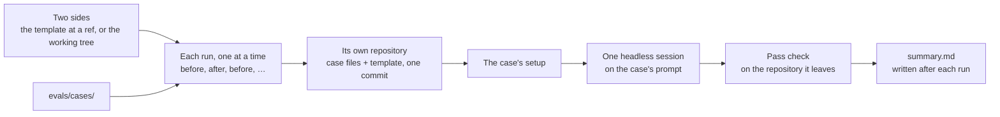

# Agent evals

Area spec. How the repository tells whether a change to the repo template makes agents do the work better or worse: an eval runs the same cases several times with the template before the change and after it, each run in a throwaway repository of its own, and shows the two side by side. It is this repository's own development tooling, run by hand with `make eval`, and not part of RepoCop, which never runs it (ADR-039). Why it is a runner of its own that runs Claude Code headless: ADR-044. Index: [index.md](index.md)

## An eval

- **Sides.** Before is the default branch on `origin` as last fetched, and after the working tree, unless `--before` or `--after` names a ref. A side is `templates/default-repo/`, read without checking anything out: at a ref with `git archive`, which keeps its files' modes, or from the working tree as git sees it, untracked files included and ignored ones left out. Both are snapshots taken as the eval starts. The cases and the runner are the working tree's on both sides, so only the template differs, and when the two templates are the same the eval says so and runs anyway, which shows the noise.
- **A run's repository** is in a private folder of its own, `repocop-eval-*` under the system's temp folder, outside the developer's checkout and home folder. It holds the case's own files, with the side's template laid over them by RepoCop's own `bootstrap` as a template sync lays it out with every offered file picked: a starter file the case has stays the case's, and `{{ repo_name }}` is the case's name. All of it is one commit on `main`, with a local bare `origin` beside it whose default branch is `main`. Git there reads the run's own configuration, so none of the developer's identity, signing or git hooks applies.
- **One at a time.** Runs alternate sides, as they share the subscription's usage limits and conditions drift over time. The next eval first removes the folders past evals left in the temp folder, and nothing else, and an eval refuses to start while another holds `evals/results/.lock`.
- **Bounds.** Every process is an argv list with a timeout, as `.claude/rules/safety.md` asks of RepoCop: a run's session has 20 minutes, a case's script 60 seconds. Git in the developer's checkout takes no optional locks, and a ref the developer names is checked as a ref before use.

## A case

A case is a folder in `evals/cases/`: a `case.toml` naming its prompt, its own files, a setup script of steps the eval takes before the session starts, without telling the agent, a pass check, and observations of the transcript that don't count toward passing. `evals/cases.py` describes the format, and what a script is given.

A pass check runs on the repository the run leaves. The runner records the repository's state as the session starts and as it ends, its branches, their commits and anything uncommitted, so a check that the agent changed nothing compares the two. A check of what the agent wrote, such as a saved review, is a plain text match, so it can pass a wrong answer or fail a right one: judging one properly waits on reviewing transcripts.

## Scoring

- **A run passes** when it is valid, its pass check holds, and its session didn't end in an error or a timeout.
- **A run is invalid**, and doesn't count, when it loaded any of the developer's own configuration, its setup failed, the service rather than the agent cut it short (a usage limit or an outage), or it ran on another model than most of the eval's runs did.
- **A case passes on a side** when every run there passes, so one failed or invalid run fails it. The eval exits 0 only when every case passes on the after side, 1 when one doesn't, and 2 when it refuses to run.
- **Variance.** At 5 runs a side, a difference of one run is noise, and 5 passes out of 5 still allow a failure rate of up to about 45% (at 95% confidence; about 18% at 15 runs). Before counting a rare failure as fixed, run with more, such as `--runs 15`. Auto mode's classifier is itself a model, so permission denials vary from run to run too.

The summary, `evals/results/<UTC time>/summary.md`, gives for each case and side the passes, the invalid runs, the median agent steps, duration, each kind of token and the denials and errors, and how many runs showed each observation, with the model, effort and Claude Code version. Each run's row links its transcript and the records of its repository's state at start and end. The summary is written again after each run, so an interrupted eval keeps what finished. A run's repository stays in the temp folder until the next eval.

## Isolation

A run loads only its repository's own instructions, skills, settings and hooks, and what Anthropic ships with Claude Code: its built-in skills, such as `simplify`, agents and plugins. It runs with `--setting-sources project`, `--strict-mcp-config` and `--no-session-persistence`, with memory, claude.ai connectors and updates turned off, and in an environment of only `PATH`, `HOME`, `SHELL`, the locale, `TERM`, `TMPDIR`, `USER` and `LOGNAME` of the developer's: no variable that changes the model, the credential or what loads. `HOME` stays for the sign-in. `--permission-mode auto` runs with the repository's own permission rules and `--permission-prompts none`, so whatever would prompt is denied, and counted.

What a run loaded is read from its events. The developer's own is told from Anthropic's by name: their user-level skills (those synced from claude.ai count unless Anthropic made them), agents, commands and output styles, and any plugin that doesn't ship with Claude Code. Any MCP server is theirs, as the template ships none, and so is a hook on an event the repository's settings don't hook. No event lists the `CLAUDE.md` files and memory a run loaded, so the eval refuses to run when a folder above the temp folder holds a `CLAUDE.md`, `CLAUDE.local.md` or `.claude/`.

## Claude Code

**Verified against the real CLI** (2026-11-16, Claude Code 2.1.282; the facts the runner and `tests/fakes/bin/claude` rely on):

1. **A headless session.** `claude -p` reads its prompt on standard input. A slash command there expands as the skill it names, with its arguments.
2. **Its events.** `--output-format stream-json --verbose` writes one JSON event a line. A `system`/`init` event gives the session's `model`, `claude_code_version`, `skills`, `slash_commands`, `agents`, `plugins` (each with a `source`, `<name>@builtin` for those Claude Code ships), `mcp_servers` and `output_style`, but no effort. `assistant` and `user` events carry tool calls and their results, a `rate_limit_event` the usage limits, and a last `result` event the session's `num_turns`, `duration_ms`, `usage` (`input_tokens`, `output_tokens`, `cache_creation_input_tokens`, `cache_read_input_tokens`), `total_cost_usd` (an estimate), `permission_denials`, `is_error` with a `subtype`, `api_error_status`, and in `result` the agent's last reply.
3. **Hooks.** `--include-hook-events` adds a `system`/`hook_started` and a `hook_response` event for each hook that runs, naming its event (`hook_event`) and matcher (`hook_name`, such as `PreToolUse:Bash`), never its command.
4. **What loads.** With `--setting-sources project`, a session loads its folder's `CLAUDE.md` and settings, and none of the user's: not `~/.claude/CLAUDE.md`, user settings such as an effort level, user skills, nor the `anthropic-skills:*` skills synced from claude.ai. Claude Code's built-in skills, agents and plugins still load. Checked by the agent's own account of the instruction files in its context, as no event lists them. With `--strict-mcp-config` and `ENABLE_CLAUDEAI_MCP_SERVERS=false`, `mcp_servers` is empty: no claude.ai connectors. `CLAUDE_CODE_DISABLE_AUTO_MEMORY=1` turns memory off, and `DISABLE_AUTOUPDATER=1` keeps the version from changing during an eval.
5. **An untrusted folder.** A headless session in a folder no one has trusted drops the project's `permissions.allow` rules, saying so on standard error, but keeps its `deny` and `ask` rules and its hooks. Trusting the folder would mean writing to the developer's own `~/.claude.json`; allow rules passed with `--settings` apply instead.
6. **Questions.** `AskUserQuestion` isn't offered headless: the agent asks in its reply, which ends the session.
7. **Sign-in.** `claude auth status --json` gives `loggedIn`, `authMethod` (`claude.ai` for a Claude subscription) and the `configDirectory` holding the user's own configuration.
