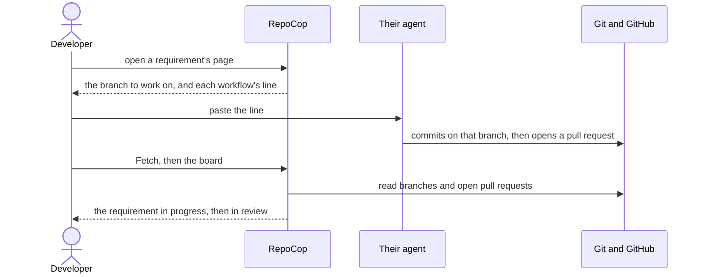

# Requirements

A requirement is a change still to be delivered in one of the developer's repositories. The developer writes it in their own editor and has their own agent deliver it; RepoCop shows each one with how to run each workflow on it, what it waits on, which workflows have run on it, and whether its review finds it ready to implement.

## Identity

A requirement is a Markdown file in the `todo/` folder of its repository's changes folder, which its developer writes and commits in their own editor, and it has no id. Its file name, without `.md`, is its name on the pages and in commit messages, and its pages are found by its repository and file name, so any name a file can have links to its own page. The file holds its text and no title heading. An older change's heading is part of its text, and an older change's `req-<n>-` prefix is part of its name.

**Read-only.** Nothing in RepoCop creates, edits or commits a requirement file. The repository's page says where to add one, and a requirement's page shows its text as the file holds it, from its folder or the archive, with an "Open in editor" link to that file ([ui.md › Editor links](ui.md#editor-links)).

## The developer's agent does the work

RepoCop runs no coding agent. For an active requirement, its page names the branch to do the work on, the requirement's name (`bulk-user-import`), so the board finds it, and gives the line that runs each of the repository's workflows on it in the developer's own agent: `/implement specs/changes/todo/bulk-user-import.md`. The workflows are the skills committed at HEAD. Each line has a Copy button ([ui.md › The shell](ui.md#the-shell)). The agent runs wherever the developer starts it, in the primary checkout or a worktree of their own, such as agent view's, and RepoCop doesn't start, manage or track it. The line runs on any branch, since the template's `/implement` puts itself on the requirement's branch first.

## Storage

- **One changes folder per repository**, set when it is registered (`changes_dir`), laid out as the repo template's specs convention says (`.claude/rules/specs.md` › Changes): `todo/` holds the requirements still to deliver, and `/complete-change` archives into `archive/` beside it, under the file's name stamped with the UTC date and time it was archived, so the archive lists changes in the order they finished. An archive made before the stamp keeps its plain name, and RepoCop finds either.
- **Location is read from disk:** `active` at its path, `archived` in the archive folder, `missing` when in neither.

## Dependencies

Each change's `depends-on` front matter (`.claude/rules/specs.md` › Dependencies) is read from disk on each page load like the rest. The board orders a repository's changes by level: those no undelivered change holds up, then those one undelivered change away, and so on, by their longest chain, and each card names what it waits on. Each requirement's page shows what it's blocked by and what it blocks. A problem (a name that matches no change or several, a change that needs itself, a cycle, a list that can't be read) is shown above the board, and the changes it holds up come after the others, marked as unable to be ordered. A name is only compared with the folder's file names, never used to build a path.

The template's `specs/changes/backlog.sh` orders the same backlog outside RepoCop, by the same rules and with the same problems, and draws it as a git-ignored Mermaid graph. RepoCop never runs a repository's scripts, so it applies the rules itself, and `tests/test_backlog.py` holds the two to the same results.

## A requirement's history

A requirement's page lists the workflows run on it, newest first, so the developer sees which steps it has had, such as a review asked for, or addressed, before asking for the next: each with the workflow, when it started, its branch, and its session.

- **Every run, whatever its age.** The runs are those in the repository's history of workflow runs, and those in its sessions' logs, which reach back before the hook kept a history ([sessions.md › The session log](sessions.md#the-session-log)). A run in both is the same session's at the same time, and counts once.
- **A run is on a requirement** by the rule a session's workflow is ([sessions.md › What a session shows](sessions.md#what-a-session-shows)): its argument's path names it, or else it was for the requirement of the first branch its session was on from its start that belongs to one, as far as the session's log, while it is there, or else the run's own branch tells.
- **Before the hook keeps one.** When the hook on the default branch on `origin`, as last fetched, doesn't keep the history yet, the page says runs show only as long as their session's log, and that a template sync brings the hook that keeps them.
- The history is as of the page load: the session lists' refresh doesn't carry it.

## A requirement's review

The developer needs to know which requirements are ready to implement: reviewed to the end, with a verdict that clears them, on the text they have now. Only the review knows it finished and what it concluded, so the repo template's `review-requirement` ends by saving its review with `save-review.sh`, beside it in its skill folder, which refuses a requirement path that leads outside the checkout and an empty review. Saving it is the review's one write: it changes nothing in the repository.

**A saved review** is `<git common dir>/repocop/reviews/<requirement's file name>`: on the developer's machine, out of every commit, shared by every worktree, replacing the requirement's last one. Its header, between `---` lines, holds:

| Field | Holds |
|-------|-------|
| `v` | the format's version, `1` |
| `requirement` | the requirement's path from the checkout's top |
| `verdict` | `yes`, `yes-with-assumptions` or `no` |
| `blocking` | how many blocking questions it asks |
| `sha256` | of the requirement's file as reviewed |
| `at` | when it was saved |

The review follows. RepoCop takes a saved review only when its `requirement` is the file's own path in the requirements folder.

A requirement stands in the first of these that applies:

| Standing | When |
|----------|------|
| Review unfinished | a review was started on it, by the history's rule for a run's requirement, after its last saved review, or with none saved: it still runs, was stopped, or ran before reviews were saved |
| Not reviewed | no review is saved |
| Changed since review | its file in the checkout differs from the one reviewed, as when the review's questions were answered: it is reviewed again, or its review completed |
| Not ready, Ready with assumptions, Ready | the saved review's verdict: `no`, with its blocking questions counted, `yes-with-assumptions`, `yes` |

**A review the developer completes** makes the requirement Ready on its text as it then is. Once the changes a review discussed are applied, reviewing again would find nothing left and cost the developer time and tokens on every requirement, so the template's `complete-requirement-review` saves the requirement's last review again over its file as it is now, with the verdict `yes` and no blocking questions, followed by a note of what was applied or that the developer marked it complete. It refuses a requirement with no saved review. The developer's word settles it, as the human keeps final control ([product.md › Design pillars](product.md#design-pillars)): completing reviews nothing, and changes nothing in the repository.

Its card shows the standing, and its page, while it is in the folder, the standing, the verdict and when it was saved, and the review itself.
