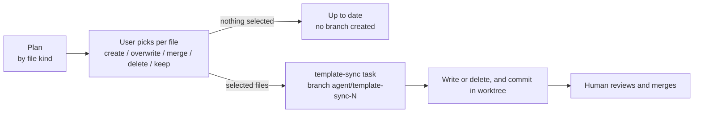
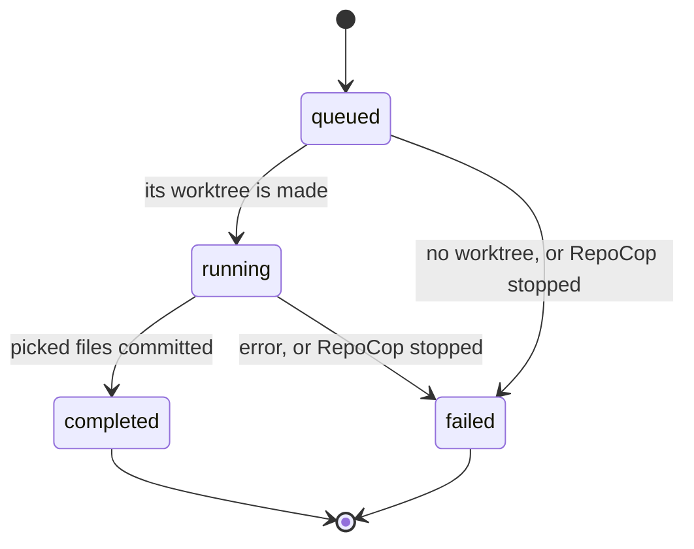

# Template sync

Sync keeps each repository in step with the repo template, and is the only way the repo template ([repo-template.md](repo-template.md)) reaches a repository, a new one's first files included. It shows what the template would change on the repository's default branch, and commits the files the developer leaves picked on a branch of its own, in a worktree of its own, which reaches the repository only through a pull request the developer merges.

## File kinds

The plan compares each template file, after substitution, against the repository. The one placeholder, `{{ repo_name }}`, is replaced with the repository's name in text files. How a file the repository has is compared depends on its kind, declared in the template's `template.toml`, which is never copied:

| Kind | Missing | Present |
|------|---------|---------|
| managed (default) | create | `identical`, or `differs`: overwrite or keep |
| starter | create | the repository's own: never offered, whatever it holds |
| merged (JSON) | create | `identical` if it has every template entry and value, else `behind the template`: merge, or keep. A file that isn't a JSON object is listed as `can't merge` with the reason |

**Managed files carry a marker** on their first line after any shebang or front matter: `<!-- managed by template -->` in Markdown, `# managed by template` in files whose comments start with `#`. A file on the branch that carries it, but that the template no longer ships, is `removed from the template`: delete, or keep. A file without it is never offered for deletion, whatever its path.

A `.gitkeep` only keeps an empty folder in the template. It isn't part of the template, so sync never offers it.

## The plan

- **It compares with the default branch on `origin`, as last fetched**, not the checkout's own branch or working tree: a merged pull request lands there, and RepoCop never pulls into the checkout. Nothing fetches on its own, so after a sync is merged, Fetch brings the status up to date. Without that branch in the checkout, the plan says to fetch first.
- **The template is the authority.** Every file the plan offers is picked by default, overwrites and deletions included, since the template is the authority for the files it offers; the user unticks a file to keep the repository's version. Only files the current plan still offers can be applied.
- **The template wins a merge:** keys and array items the repository lacks are added, and wherever both have a value that isn't an object or array on both sides, or their types differ, the template's replaces the repository's. Keys and array items only the repository has stay. A merge offers again an entry the repository removed or changed on purpose, so a merged template file holds only what every repository must have.
- No template version tracking and no three-way merge. A managed file that differs is kept or overwritten whole.

## Committing a sync

- **Never in the primary checkout.** The picked files are committed on a `template-sync` task's own branch, `agent/template-sync-<id>`, in its own worktree, `<worktrees_root>/<repo>/template-sync-<id>`, started from the commit the plan compared with, and the human reviews and merges it through its [pull request](#pull-requests). Nothing picked means no task and no branch. A failure fails the task and keeps the worktree.
- **Its worktree stays in its place.** A worktree is only ever at its path under `<worktrees_root>/<repo>/`. Anything that would put one elsewhere, such as inside a primary checkout, is refused, and a path there counts as the repository's worktree only if its git common directory is the primary checkout's. A folder or branch that is already there is never reused. Every branch RepoCop names starts `agent/`, so a person can tell it from their own.

## Waiting to land

A completed sync waits until it lands. While its worktree is there and its branch has a template file, or a retired file's deletion, that the default branch on `origin` still lacks, the repository's status shows `sync #N not on <default branch>`, linking to the sync's page, where its pull request is pushed and opened. RepoCop learns of a merge only from a fetch, so the repository's page, the sync's page and the Sync page each say what is left, with a Fetch button beside it: open its pull request, or merge the one last known for its branch, then fetch. The Sync page shows this instead of offering picks, and no other sync starts, so the same files are never on two branches. It's judged by the files, so a squash merge counts once it's fetched, and a sync the template has moved past stops waiting.

## Where each sync stands

Each completed sync shows where it stands on the repository's page: `waiting`, `on origin` when every file it changed has the same content on the default branch there, `not on origin` once a newer sync or template change has replaced it, or `removed`. Remove deletes a completed sync's worktree and branch, only on that click and never forced, so it's refused while the worktree has uncommitted changes. A pushed branch and its pull request stay on GitHub, and removing a waiting sync lets Sync offer its files again.

## A sync's page

A template sync's page shows its status, branch and worktree, what it committed, and its worktree's git status and diff since the base commit, untracked files included. The diff is read-only and capped in size, and the page says when part was left out. A sync is done within the request that applies it, so the page doesn't refresh itself.

## Status machine

A template sync's task goes through these within the request that applies it.

**Restart recovery.** At startup no sync is under way, so a task still `queued` or `running` is one a stopped RepoCop cut off: it becomes `failed`, and its page says RepoCop stopped while it was committing the sync. Its worktree stays as it was. Nothing restarts on its own: a failed sync doesn't wait to land, so the Sync page offers its files again.

## Pull requests

A completed template sync's page acts on the pull request of its branch.

| Action | What it does |
|--------|--------------|
| Open PR | Pushes the branch to `origin` with its upstream set, then opens a pull request into the default branch, ready for review, titled "Sync with the repo template" and listing the files it changed, and shows it on GitHub in a new tab |
| Push | Sends the branch's new commits to the pull request |
| Request Copilot review | Asks Copilot to review the pull request, again if it already has |

- **Only on a click.** No sync, status change or page load pushes or writes to GitHub. Until its pull request is opened, a branch is only on RepoCop's host, and its page says so.
- **Refused, with the reason on the page, before anything is pushed:** the cases in `.claude/rules/safety.md` › Pushing, and when `origin` isn't on github.com, when its push URLs send the branch to any repository but the registered remote, where the pull request is opened, or when `gh` is missing or logged out.
- **GitHub is asked at each click.** Every action first asks for the branch's open pull request and remembers it, whoever opened it. A sync's page reads nothing from GitHub when it loads; only the boards do, to show stages ([board.md](board.md)). With one open, Open PR is refused and the page links to it instead of making a second. With none open, as after a merge, Push and Request Copilot review are refused and Open PR makes a new one. Between clicks the page shows the last one it knew of.
- **GitHub is reached through `gh`**, which is optional: without it only these actions are refused. Merging stays on GitHub. Once merged, a sync's branch and worktree go through Remove on the repository's page ([Where each sync stands](#where-each-sync-stands)), not through its merged branches list.
