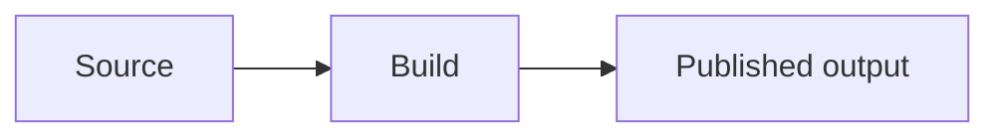

# Architecture — {{ repo_name }}

Root design file. It says *how* the work is built; *why* is in [product.md](product.md), how a part behaves is in its area spec, listed in [index.md](index.md), and why an architecturally significant choice was made is in [decisions/](decisions/). Keep it describing what's built (or decided). Diagrams are Mermaid, so they stay text, diffable, and mergeable.

## Goals

_TBD: what the way the work is built must achieve, such as running offline or staying deterministic for software, or publishing to print and the web from one source for writing and media._

## Parts

_TBD: the main parts, each with its role in a few lines and a link to the area spec for how it behaves, and what each may depend on: components for software, or sections, series and assets for writing and media._

## Contracts

_TBD: what the parts agree on between them: interfaces, protocols and stored formats for software, or the structure, style and metadata every section or asset follows for writing and media._

## Key flows

_TBD: the sequences that matter, such as a request through the system or a post from draft to published._

## Where things live

_TBD: where each part's files are, such as source folders and config for software, or drafts, assets and published output for writing and media._
