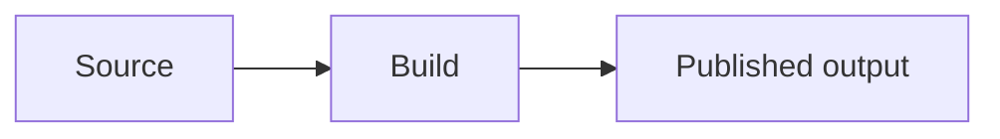

# Architecture — {{ repo_name }}

Root design file. It covers *how* the work is put together; *why* is in [product.md](product.md), and why a significant choice was made is in [decisions/](decisions/). Keep it describing what's built (or decided). Diagrams are Mermaid, so they stay text, diffable, and mergeable.

## Structure

_TBD: the main parts and how they relate: components and their interfaces for software, or sections, series and assets for writing and media._

## Data model

_TBD: the data the parts share: records and schemas for software, or content types and their metadata for writing and media._

## Key flows

_TBD: the sequences that matter, such as a request through the system or a post from draft to published._
